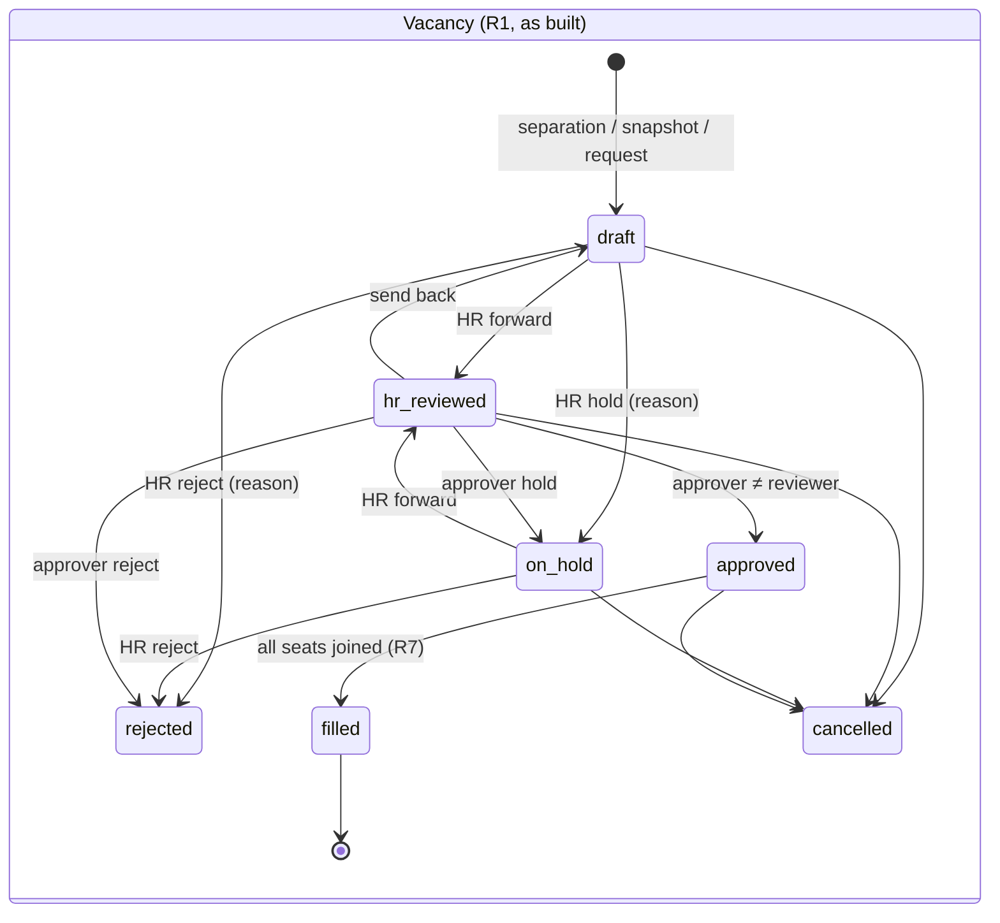
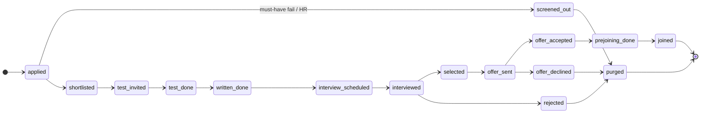

# Onboarding Process — Architecture (workforce planning → recruitment → joining)

> Module handbook. Read this before touching any file of the module, and update it after every build step
> (status table §1, file map §3, schema §5, RPCs §7). The project-wide handbook is `memory.md` (repo root);
> this file owns the details of this module and `memory.md` points here.

Status: **R1 built** (2026-10-25; applied on Supabase, test passed). **R2 built** (2026-10-25; applied on Supabase, test passed).
**R3 built** (2026-10-25; migration not applied, Edge Function `recruit-ai` not deployed).
**R3–R5 applied** on Supabase (probed 2026-10-25), Edge Functions `recruit-ai` and `recruit-notify` deployed.
**R6 + R7 built** (2026-10-25; not applied) — the hiring cycle is complete end to end.
Final settlement is a **separate module, built later**.

---------------------------------------------------------------------------------------------------------------------
## 0. What the module does (one paragraph)

The system measures each department's workload against its capacity every month. When a department is overloaded,
or someone leaves a sanctioned position, a **vacancy is drafted automatically** and goes through approval. An approved
vacancy becomes a **job post auto-filled from the designation's job profile**, published on the company's own
careers page. Applications (own form, email, LinkedIn, Bdjobs) land in temporary CV storage, are parsed and
**ATS-scored**, and shortlisted applicants take the **online objective test on our own recruitment page**, so their
score reaches the admin dashboard at once. A written test on paper follows, then an interview is scheduled within
15 days. Applicants get an email (later SMS) with a pre-interview form, a panel of 1–4 interviewers scores online,
and a composite result is computed. The selected person gets an offer and a mandatory pre-joining form
(NID, photo, nominee, bank). On the joining day the person becomes an employee automatically, documents are
generated pre-filled for printing and signing, and a named joining-day feedback form is sent.

---------------------------------------------------------------------------------------------------------------------
## 1. Build steps and status

| Step | Content | Status |
|---|---|---|
| **R1** | Headcount plan, workload (4 methods, (?) tooltips), vacancy draft + approval, workforce dashboard, 10 demo cases | ✅ applied, `recruit_r1_workforce_test.sql` passed on Supabase |
| **R2** | Job profiles → job post (text + poster) → careers page + apply form + temporary CV storage | ✅ applied, `recruit_r2_job_posts_test.sql` passed on Supabase |
| **R3** | CV reading (AI or Basic/markdown), must-have gate, ATS score, profile modal, shortlist, question bank + per-post papers, Settings → AI key | ✅ code done, tests pass locally; ⏳ apply `20261027000100_recruit_r3_screening.sql`, run `recruit_r3_screening_test.sql`, deploy `recruit-ai` |
| **R4** | Online objective test (own page), written-test marks entry, interview scheduling | ✅ code done, tests pass locally; ⏳ apply `20261028000100_recruit_r4_tests_interviews.sql` + run `recruit_r4_tests_interviews_test.sql` |
| **R5** | Email (now) / SMS (coded, off), pre-interview form, interviewer kit, panel scoring, composite result | ✅ code done, tests pass locally; ⏳ apply `20261029000100_recruit_r5_messages_interviews.sql`, run its test, deploy `recruit-notify` |
| **R6** | Offer (maker-checker) / reject email, pre-joining form (NID, photo, nominee, bank) | ✅ code done, tests pass locally; ⏳ apply `20261030000100_recruit_r6_offers.sql` |
| **R7** | Joining automation (pre-hire → employee), documents to print and sign, joining feedback, data purge | ✅ code done; ⏳ apply `20261031000100_recruit_r7_joining.sql`, then run `recruit_r6_r7_offer_joining_test.sql` |
| Later | Final settlement (separate module) | — |

Every step: migration + SQL golden test + pure-TS mirror with vitest + UI, then `npm run test:all`, typecheck,
build, commit, update this file and `memory.md` A9.

---------------------------------------------------------------------------------------------------------------------
## 2. Decisions (user answers 2026-10-25)

| # | Topic | Decision |
|---|---|---|
| 1 | Order | Onboarding/recruitment first; final settlement later as its own module. |
| 2 | Headcount | Companies set **sanctioned headcount** in the system (new headcount plan). |
| 3 | Vacancy | **Auto-drafted** (separation or overload); a person approves. |
| 4 | Workload | Linked to **output data**, not only attendance/OT. Method per department. Every formula and its source on a (?) hover. Sources verified, never typed from memory. |
| 5 | AI | Claude API now (platform key for testing). Each company can paste **its own API key** in Settings → Integrations (masked input, save, test, remove). Without any key the module runs in manual mode. |
| 6 | Messaging | **Email now** (testing phase). **SMS adapter coded but switched off** until a gateway account exists. |
| 7 | Tests | **Own recruitment page** for the objective test (no Google Form): submitting updates the score on the admin dashboard immediately. Written test stays on paper; HR enters marks. |
| 8 | Score | Default weights ATS 10 / Objective 25 / Written 20 / Interview 45 (editable per post, sum 100). Objective test has an **aptitude/reasoning section** instead of "IQ". "Confidence" = a category the **interviewer scores**. |
| 9 | Threshold | Overload = index ≥ 1.10 for 2 months in a row, or ≥ 1.25 in one month (explained in §6.4; company can change). |
| 10 | CV retention | **No retention after the process.** When the vacancy closes: rejected applicants are purged from the system; selected ones move into the employee record (photo/NID only; the CV is deleted too). |
| 11 | Applicant view | Clicking an applicant row opens the **full profile in a modal**. |
| 12 | Salary on post | **Toggle per post**: on → admin enters min/max; off → "Negotiable". |
| 13 | Joining feedback | **Named**, not anonymous. |
| 14 | Approval chain | *Default until the user says otherwise*: vacancy = drafted (system/Manager) → HR review → Admin approve (budget); offer = HR prepares → Admin approves (preparer ≠ approver). |
| 15 | Architecture | Recruitment needs outside calls (AI, email, SMS, captcha) → **Supabase Edge Functions** for those three jobs only (§9). Everything else stays in Postgres RPCs. |
| 17 | CV reading (2026-10-25) | Per company (post can override): **AI mode** (Claude extracts years, education, skills, roles + relevance) or **Basic mode** (no AI: PDF/DOCX → markdown with JavaScript libraries inside the Edge Function, MarkItDown-like, no Python server; skills by keyword match against the job profile, years estimated from dates, relevance entered by HR). AI mode falls back to Basic when no key / error. HR can correct every profile; AI never rejects anyone. Scanned PDFs in Basic mode → HR enters the data. |
| 18 | Question papers (2026-10-25) | Per post: objective, written or both (question, options, correct answer, marks, section; written: marks + model answer). Saved to a **question bank per designation**; the next post for that designation starts from it. Editable per post; on save the user picks "this post only" or "also update the bank". Sources: typed in the system, Excel paste, or AI draft (AI mode only, needs approval). Paper locks once a test starts (changes → new version). Answer key never reaches the applicant. Moved from R4 into R3. |
| 19 | Who may do recruitment (2026-10-25) | Only **Admin, HR Manager, Manager**; employees see nothing. Manager: **own department only**; default (unanswered): Manager may view and set question papers, publish / shortlist stay with HR and Admin. Interview panel (R5): a Manager may assign any employee as interviewer; that employee can only score the applicants assigned to them. |
| 20 | Email provider (R5 build, 2026-10-25) | Not answered → **Resend** (HTTPS API, works from Edge Functions; the company verifies its domain there). SMS: generic HTTP gateway adapter (field names configurable), off until the Admin enables it. |
| 21 | Interview scoring (R5 build, 2026-10-25) | Five categories 1–5 (job knowledge, communication, problem solving, **confidence**, team & culture fit) + recommendation + comment. Interviewers see others' scores only after scoring. Interview done when the whole panel has scored. Suggested questions are built from the profile and the gaps (no AI). |
| 22 | Offer and pre-joining (R6 build, 2026-10-25) | Decision on the Results tab (selected within the seats / waitlist / not selected with optional email). Offer: HR prepares, a holder of `offer.approve` (Admin by default) who did not prepare it approves; one link `/offer/<token>` to accept and then fill the pre-joining form. **No email OTP** (planned earlier): the link goes only to the applicant's email, and NID / account numbers are write-only (never shown back), so a leaked link cannot read them. |
| 23 | Joining and purge (R7 build, 2026-10-25) | HR converts after verifying the form (no automatic conversion on the date yet — pg_cron later). Starting pay is written from the approved offer (the approval is the maker-checker; `compensation.edit` is not asked again). Documents are printed from the browser; signed scans uploaded. Close hiring: the app deletes the CV / photo files through Storage (Supabase blocks deleting storage rows in SQL), then the database clears every applicant's personal data. |
| 16 | Apply without an Edge Function (R2 build, 2026-10-25) | The apply form works with anon RPCs and a direct upload to the private bucket (only the returned path, within 1 hour, once, then token confirm). Honeypot + rate limit for now; captcha moves into an Edge Function when R3 brings the first one. |

---------------------------------------------------------------------------------------------------------------------
## 3. Where things live (file map)

Core logic lives in **`src/onboarding-process/`** (this folder). Two kinds of code must stay outside it because
the tooling expects them there:
- SQL migrations and tests → `supabase/migrations/`, `supabase/tests/` (the PGlite runner `scripts/db-test/run.mjs`
  and the manual SQL-Editor apply order read only those folders).
- Edge Functions → `supabase/functions/<name>/` (Supabase's required layout).

✅ = exists (R1, R2), ⏳ = planned.
```
src/onboarding-process/                 ← core of the module (import as @/onboarding-process/...)
  architecture.md                       ✅ this file
  core/
    types.ts                            ✅ shared types (figures, dashboard, vacancy, job profile/post, applicant, public post)
    workload.ts                         ✅ capacity, index, required FTE, gap, attrition, suggestion rules (mirror of SQL)
    explain.ts                          ✅ text for every (?) tooltip: formula, numbers filled in, reference keys
    workflow.ts                         ✅ vacancy status labels + which actions a viewer gets (maker-checker)
    inputCsv.ts                         ✅ pasted spreadsheet rows → output / volume figures
    jobPost.ts                          ✅ labels, salary text ("Negotiable"), deadline, weights, CV rules, pasted applicants
    markdown.ts                         ✅ safe Markdown subset (## / - / **bold**) → blocks; section items for the poster
    poster.ts                           ✅ poster content (facts, requirements, salary, deadline, URL) + word wrap
    ats.ts                              ✅ must-have gate + ATS score breakdown (mirror of private.ats_figures)
    questions.ts                        ✅ sections, question checks, Excel paste parser, total marks
    assessment.ts                       ✅ objective scoring by section (mirror of score_invite), written %, timer, time zones
    composite.ts                        ✅ composite + interview % + spread flag (mirror of private.composite_figures)
    interview.ts                        ✅ categories, scale, recommendations, templates + placeholders, suggested questions
    joining.ts                          ✅ offer / pre-joining / task / document labels, feedback questions, the 4 printable
                                           documents (HTML, every value escaped)
    composite.ts                        ⏳ composite score, weight renormalisation, interviewer spread flag
    schedule.ts                         ⏳ 15-day window, slot proposal around leave/holiday/weekly off
  demo/
    workloadCases.ts                    ✅ the 10 demo cases + expected results (§6.7)
    jobPostDemo.ts                      ✅ sample post (demo case 5) for /preview/job-post
  integrations/
    providers.ts                        ⏳ provider ids and config shapes (ai: claude; email: resend|smtp; sms: …)
  __tests__/
    workload.test.ts                    ✅ golden numbers = SQL test numbers
    jobPost.test.ts                     ✅ salary toggle, deadline, weights, CV rules, pasted rows, markdown, poster
    screening.test.ts                   ✅ the 5 ATS cases + Alpha applicants (= SQL test), question checks, Excel paste
    assessment.test.ts                  ✅ Rahim 60.0 % / Karim 40.0 % (= R4 SQL test), written 70.0 %, clock, Dhaka time
    interview.test.ts                   ✅ composite 76.2 / 79.0 / spread / Rahim 73.06 (= R5 SQL test), templates, questions
    joining.test.ts                     ✅ documents escape values, appointment letter from the offer, 4 pages, NID rule

src/lib/onboarding.ts                   ✅ React Query hooks (dashboard, vacancies, any workforce RPC)
src/lib/recruit.ts                      ✅ hooks: posts, profiles, applicants, CV upload/open, public careers + apply;
                                           R3: settings, papers, callRecruitAi (Edge Function), useReadCvs (rounds of 5)
src/components/InfoTip.tsx              ✅ the (?) popover (formula, working, references)
src/components/Markdown.tsx             ✅ renders core/markdown.ts blocks as elements (never raw HTML)
src/pages/onboarding/
  WorkforcePage.tsx                     ✅ /workforce: month, Build, KPIs, department cards, tabs
  WorkforceSetup.tsx                    ✅ tabs Output data · Plan & methods · Settings
  WorkforceDemo.tsx                     ✅ tab Demo cases + /preview/workforce (dev, no login)
  WorkloadCard.tsx                      ✅ one department: gauge, figures with (?), suggestion
  VacanciesPage.tsx                     ✅ /vacancies: needs my action / open / closed
  dialogs/VacancyDialog.tsx             ✅ detail, workload, history, review / approve actions
  dialogs/DraftVacancyDialog.tsx        ✅ manual request
  JobPostsPage.tsx                      ✅ /job-posts: Ready to post · Posts · Job profiles
  JobPostPage.tsx                       ✅ /job-posts/:id editor (salary toggle, deadline, link, weights), text/poster
                                           preview, publish/close, apply link; JobPostDemoPage = /preview/job-post
  JobPoster.tsx                         ✅ canvas poster 1080×1350, 4 themes, QR, PNG download
  ApplicantsPanel.tsx                   ✅ applicants table (score + gate, filters), CV reading bar, shortlist / screen out
  QuestionPapersPanel.tsx               ✅ objective / written papers: bank, blank, Excel paste, AI draft, editor, save to bank
  RecruitmentSettingsPage.tsx           ✅ /settings/recruitment: CV reading mode, Claude key (Admin)
  TestsPanel.tsx                        ✅ Tests & interviews board: links, scores by section, written marks, interviews
  dialogs/InviteLinksDialog.tsx         ✅ create test links (shown once): copy / ready email
  dialogs/WrittenMarksDialog.tsx        ✅ marks per question with marking points
  dialogs/InterviewDialog.tsx           ✅ panel 1–4, "Propose a time", date/time in the org time zone, mode, cancel,
                                           "Save and send invitation" (R5)
  ResultsPanel.tsx                      ✅ Results tab: composite ranking, components × effective weight, panel, spread flag
  OutboxPanel.tsx                       ✅ Messages tab: email/SMS status, errors, Send now, Retry
  MessagingSettings.tsx                 ✅ Email (Resend) / SMS (gateway) cards with test send; template editor
  OffersPanel.tsx                       ✅ Offers & joining tab (HR): seats, offer / pre-joining / joining per person, close hiring
  dialogs/OfferDialogs.tsx              ✅ Decision, Offer, Approve, Send, Withdraw, Pre-joining review, Convert, Close & purge
  dialogs/OnboardingCaseDialog.tsx      ✅ checklist, print documents, upload signed scans, feedback, complete
src/pages/interviews/MyInterviewsPage.tsx ✅ /my-interviews: interviews where I am on the panel (any employee)
src/pages/interviews/InterviewKitPage.tsx ✅ /my-interviews/:id: results so far, form answers, questions, scoring form
  dialogs/JobProfileDialog.tsx          ✅ experience, education + subjects, skills, duties, employment type
  dialogs/ApplicantDialog.tsx           ✅ applicant profile modal: contact, CV, ATS bars + formula, gate reasons,
                                           AI summary, HR "Correct" form, CV text, history
  dialogs/AddApplicantsDialog.tsx       ✅ paste rows from email / LinkedIn / Bdjobs / referral
  (R3+)                                 ⏳ Assessments, Interviews, Offers, Onboarding
src/pages/public/careers/CareersPages.tsx ✅ /careers/:orgCode list · /careers/:orgCode/:slug detail + apply form
src/pages/public/careers/TestPage.tsx   ✅ /t/:token online test: start screen, server timer, autosave, submit
src/pages/public/careers/PreinterviewFormPage.tsx ✅ /f/:token pre-interview form (attendance, notice, salary, questions)
src/pages/public/careers/OfferPage.tsx  ✅ /offer/:token offer (accept / decline) + pre-joining form (NID, nominees, account, photo)
src/pages/public/careers/JoiningFeedbackPage.tsx ✅ /joining-feedback/:token named feedback (4 × 1–5 + comment)
src/pages/settings/IntegrationsPage.tsx ⏳ AI key / email / SMS settings (admin only)

supabase/migrations/20261025000100_recruit_r1_workforce.sql   ✅ R1
supabase/migrations/20261026000100_recruit_r2_job_posts.sql   ✅ R2
supabase/tests/recruit_r1_workforce_test.sql                  ✅ R1 golden test (9 checks)
supabase/tests/recruit_r2_job_posts_test.sql                  ✅ R2 test (12 checks)
supabase/migrations/20261027000100_recruit_r3_screening.sql   ✅ R3
supabase/tests/recruit_r3_screening_test.sql                  ✅ R3 test (10 checks)
supabase/functions/recruit-ai/index.ts                        ✅ R3 Edge Function (read CVs, draft questions, test key)
supabase/migrations/20261028000100_recruit_r4_tests_interviews.sql ✅ R4
supabase/tests/recruit_r4_tests_interviews_test.sql           ✅ R4 test (9 checks)
supabase/migrations/20261029000100_recruit_r5_messages_interviews.sql ✅ R5
supabase/tests/recruit_r5_messages_interviews_test.sql        ✅ R5 test (8 checks)
supabase/functions/recruit-notify/index.ts                    ✅ R5 Edge Function (send queue: Resend / SMS gateway; test send)
supabase/migrations/20261030000100_recruit_r6_offers.sql      ✅ R6
supabase/migrations/20261031000100_recruit_r7_joining.sql     ✅ R7
supabase/tests/recruit_r6_r7_offer_joining_test.sql           ✅ R6 + R7 end-to-end test (9 checks)
```
Also touched in R1: `statutory_references` gains category `industry_practice` and area `workforce`
(`src/lib/statutory.ts`, `components/references.tsx`, `ReferencesPage.tsx`); nav section **Hiring** in `AppLayout.tsx`;
routes in `router.tsx`. R2: nav item Job posts, public `/careers/…` routes, `scripts/db-test/supabase-stub.sql`
grants anon on `storage.objects` (as Supabase does).

---------------------------------------------------------------------------------------------------------------------
## 4. Process flow

### 4.1 End-to-end graph

```mermaid
flowchart TD
  subgraph R1["R1 · Workforce planning"]
    IN["Monthly inputs<br/>attendance + approved OT (Part 2)<br/>output × SMV · volumes × std time · staffing ratio"] --> SNAP["Workload snapshot per department<br/>index · required FTE · gap · vacancy · attrition"]
    SEP["Employee leaves<br/>(deactivate_employee)"] --> VD
    SNAP -->|"backfill rule or overload rule"| VD["Vacancy DRAFT (auto)"]
    VD --> HRR{"HR review"}
    HRR -->|"send back / hold"| VD
    HRR --> ADM{"Admin approve<br/>(budget check)"}
    ADM -->|"reject / hold"| HOLD["On hold / rejected"]
  end

  subgraph R2["R2 · Job post and applications"]
    ADM -->|"approved"| JP["Job post auto-filled<br/>from designation job profile"]
    JP --> PUB["Publish: careers page + link + poster (QR)"]
    PUB --> CH["Applications<br/>own form · email · LinkedIn · Bdjobs (HR upload)"]
    CH --> CV[("Temporary CV storage<br/>private bucket")]
  end

  subgraph R3["R3 · Screening"]
    CV --> PARSE["Parse CV → structured profile + markdown"]
    PARSE --> GATE{"Must-have gate<br/>experience · education"}
    GATE -->|"fail"| REJ
    GATE -->|"pass"| ATS["ATS score 0–100 with breakdown"]
    ATS --> TABLE["Report table · sort · filter · profile modal"]
    TABLE --> SL["Shortlist (HR)"]
  end

  subgraph R4["R4 · Tests and scheduling"]
    SL --> QG["AI drafts questions → HR reviews → bank"]
    QG --> OBJ["Online objective test (own page)<br/>auto-scored → dashboard"]
    OBJ --> WR["Written test on paper<br/>HR enters marks"]
    WR --> SCH["Interview proposed ≤ 15 days<br/>HR can edit / delete"]
  end

  subgraph R5["R5 · Interview"]
    SCH --> MSG["Email (SMS later) with pre-interview form link"]
    MSG --> KIT["Interviewer kit: profile, scores, AI questions, rubric"]
    KIT --> PANEL["1–4 interviewers score independently"]
    PANEL --> COMP["Composite result (+ PMS for internal candidates)"]
  end

  subgraph R6["R6 · Decision"]
    COMP --> OFF["Offer prepared (HR) → approved (Admin)"]
    COMP -->|"not selected"| REJ["Reject email"]
    OFF --> PJ["Offer email + mandatory pre-joining form<br/>NID · photo · nominee · bank"]
  end

  subgraph R7["R7 · Joining"]
    PJ --> CONV["Joining day: pre-hire → employee (auto)<br/>card ID · pay · shift · leave · reporting · portal"]
    CONV --> DOCS["Documents pre-filled → HR prints → joiner signs → scan uploaded"]
    CONV --> FB["Named joining-day feedback form"]
  end

  REJ --> CLOSE["Vacancy closed → purge rejected applicants' data"]
  DOCS --> CLOSE
```



### 4.2 Status machines





Other statuses: job post `draft → published → closed | cancelled`; offer `draft → approved → sent → accepted |
declined | expired`; interview `proposed → confirmed → done | rescheduled | cancelled`; notification
`queued → sent | failed`; AI job `queued → running → done | failed`. Allowed transitions are enforced in SQL; the
same table lives in `core/workflow.ts` only to show/hide buttons.

---------------------------------------------------------------------------------------------------------------------
## 5. Data schema (planned) — `public` unless noted

Conventions as in the rest of the project: `id uuid`, `org_id` + composite FKs `(org_id, id)`, standard triggers
(`attach_standard_triggers`: updated_at/by, audit, soft delete), closed tables (API roles read through views/RPCs),
money `numeric(12,2)`, dates in org timezone.

**R1 — workforce (built)**
- `workforce_settings` (pk org_id): `capacity_hours` 208, `availability_source` attendance|fixed,
  `fixed_availability_percent` 100, `band_underload` 0.85, `band_watch` 1.00, `band_overload` 1.10, `band_critical` 1.25,
  `sustain_months` 2, `attrition_flag_percent` 20, `confirmed_at/by` (cleared on every save without confirm).
- `department_workforce` (pk department_id): `method` hours|output_smv|volume_std|ratio, `per_employees` (ratio),
  `monthly_budget` (department salary budget, null = no check). Missing row = hours method, no budget.
- `headcount_plans`: one row per designation (`designation_id` unique, composite FK to department + designation),
  `sanctioned`. History through the audit log; each snapshot keeps the numbers it used. Office-level plans: later.
- `workload_inputs`: department_id, `period_month` (1st), `metric_key`, `label`, `quantity`, `std_minutes`,
  `source` manual|csv. Unique (department, month, metric_key); replaced as a set (rows may be deleted; audited).
- `workload_snapshots`: department_id, period_month (unique pair), `method`, `workload_index`, `band`, `action`,
  `figures` jsonb (= every output of the calculation + the facts: availability, regular/OT hours, org headcount,
  budget, payroll), `built_at/by`. Rebuilt idempotently. No soft-delete trigger (derived data).
- `vacancies`: department_id, designation_id, office_id, `seats`, `reason` replacement|new_position,
  `origin` separation|snapshot|manual, `separated_employee_id`, `snapshot_id`, `period_month`,
  `estimated_monthly_cost`, `budget_status` ok|blocked|unknown, `recommendation` jsonb (figures at draft time),
  `note`, `status` (§4.2), `hr_reviewed_by/at`, `decided_by/at`, `decision_note`; `created_by` null = system.
- `vacancy_events` (append-only: event, from/to status, note, actor).

**R2 — job profiles, posts, applicants (built)**
- `job_profiles` (one per designation, `designation_id` unique): `experience_min_years` (0–50),
  `experience_max_years` (optional), `education_level` any|ssc|hsc|diploma|bachelor|masters|phd,
  `education_subjects` text[], `required_skills` text[] (≤ 20), `nice_skills` text[], `duties` (10–4,000 chars, one per
  line), `employment_type`, `version` (+1 on every save). History through the audit log.
- `job_posts` (one per vacancy, `vacancy_id` unique): `profile` jsonb copy + `profile_version` (later profile edits never
  change the post), `title`, `description_md` (written by `private.job_post_markdown`), `location` (vacancy office, else
  where most of the department works), `seats`, `employment_type`, `show_salary` + `salary_min/max` (check: shown ⇒
  min > 0 and max ≥ min; hidden ⇒ cleared), `deadline` (default today + 14, at most + 90), `public_slug` (unique per org,
  fixed once published), `poster` {theme orange|navy|green|maroon}, `weights` {ats, objective, written, interview}
  whole numbers summing to 100 (default 10/25/20/45), `has_written_test`, `status` draft|published|closed|cancelled,
  published/closed at/by, `close_note`.
- `applicants`: job_post_id, `full_name`, `email` (lower-cased), `phone` (+8801…), `source`
  form|email|linkedin|bdjobs|referral|other, `consent_at` (form only), `cover_note`, `cv_path`, `cv_uploaded_at`,
  `cv_upload_token_hash` (sha-256 of the one-time upload token), `is_internal` + `employee_id` (later), `status` (§4.2),
  `purged_at`. Unique (job_post_id, lower(email)) while not purged. Own audit trigger: ids, status, source, has_cv and the
  **names** of changed fields only.
- `applicant_events` (append-only: applied, added_by_hr, cv_uploaded, cv_attached; no personal data).
- `private.apply_log` (org, sha-256 of IP and email, time; rows older than a day are deleted on each apply).
- Storage bucket `recruit-cvs/{org}/{job_post}/{applicant}.pdf|docx` (private, ≤ 5 MB, PDF/DOCX MIME types).
  Policies: anon/authenticated **insert** only where `policy_checks.recruit_cv_pending(name)` (a form application
  asked for exactly this path, not confirmed yet, < 1 hour old); HR with `recruit.manage` read/write files of their own
  org's applicants (`private.recruit_cv_access`).

**R3 — screening, question papers, AI key (built)**
- `recruit_settings` (pk org_id): `cv_mode` basic|ai (default basic). `job_posts.cv_mode` (null = company setting).
- `org_integrations` (unique org + kind 'ai'): provider anthropic, `enabled`, `model`
  claude-opus-5-5 (default) | claude-sonnet-5-5 | claude-haiku-5-5, `secret_enc` (`private.encrypt_secret`, the
  payment-account key), `secret_last4`, `tested_at/test_status/test_message`. No row audit (the RPCs log the event
  without the key).
- `applicant_profiles` (pk applicant_id): `status` reading|done|failed, `mode_used` ai|basic|manual, `markdown` (CV
  text), `summary` (AI), `years` + `years_source` ai|estimate|hr, `education_level` + source, `skills_found` (AI),
  `matched_required`, `matched_nice`, `subject_matched`, `relevance` 0–15 + reason + source ai|hr, `figures` jsonb
  (= `private.ats_figures` output), `ats_score`, `gate` pass|fail|review, `ai_model`, `ai_error`, `error`,
  `claimed_at`, `read_at`. Personal data → no row audit; RPCs log ids, score and gate only.
- `applicant_decisions` (append-only): from/to status, gate at the time, note (reason), actor.
- `question_bank` (per designation, kind objective|written, position, `section`
  aptitude|job_knowledge|language|situational|general, `stem`, `options` jsonb, `correct_index`, `model_answer`,
  `marks`): replaced as a set when a paper is saved with "also update the bank". Audited.
- `question_papers` (unique post + kind): `duration_minutes` (objective required), `pass_percent`, `total_marks`,
  `question_count`, `version`, `locked_at` (set by R4 when the test starts; locked papers refuse changes).
- `paper_questions` (paper, position, same question fields; replaced as a set on save).
- No `ai_jobs` queue (planned earlier): the Edge Function claims applicants (`claim_cv_reads`) and saves each result
  directly (`save_cv_read`); token usage is not stored yet.

**R4 — tests and scheduling (built)**
- Papers come from R3 (`question_papers` / `paper_questions`); no separate `assessments` table. No negative marking.
- `assessment_invites`: applicant, paper, `paper_version`, `token_hash` (sha-256 of a 48-hex-char token; the raw token
  is returned once to HR), `question_order` int[] (shuffled per applicant), `status`
  invited|started|submitted|expired|cancelled, `expires_at` (1–14 days, default 3), `started_at`, `deadline_at`
  (= start + duration; answers accepted until +30 s), `submitted_at`, `auto_submitted`. One open/started/submitted
  invite per applicant and paper. The first invite locks the objective paper.
- `assessment_answers` (invite + position, chosen_index; upserted while running).
- `assessment_results` (score, total, percent, answered, correct, `section_scores` {section: score/total/percent},
  `passed` vs the paper's pass mark, or null).
- `written_marks` (unique applicant + paper; marks [{position, marks}], score, total, percent, passed; audited). The
  first marks lock the written paper.
- `interview_schedules`: applicant, post, `starts_at`, `duration_minutes` (15–240, default 45), `mode`
  in_person|online, `location` / `online_link` (https only), `panel` uuid[] (1–4 active employees), `due_by`,
  `late_reason` (needed after the due date), `status` scheduled|done|cancelled, `prev_status` (restored on cancel),
  `note`, `cancel_reason`, `proposed_by` system|user. One scheduled interview per applicant. Audited.
- Applicant status: shortlisted → test_invited (link) → test_done (submit / time up) → written_done (marks) →
  interview_scheduled. Steps can be skipped (written-only post, interview straight after shortlist).

**R5 — messaging and interview (built)**
- `org_messaging` (unique org + channel): email = provider `resend` (config from_name, from_address), sms = `http`
  (config url, method, to/text/key/sender field names, sender_id); `enabled` (SMS off by default), `secret_enc`,
  `secret_last4`, test result. No row audit (RPCs log without the key).
- `message_templates` (unique org + key + channel; keys test_invite, interview_invite, rejection, offer; email needs a
  subject; `{placeholders}`). Defaults seeded in English for every company (`private.seed_message_templates`).
- `notifications` (outbox): applicant, post, template_key, channel, `to_address`, rendered `subject` / `body`, `status`
  queued|sending|sent|failed, `provider_ref`, `error`, `attempts`, `claimed_at`, `sent_at`. Holds names and links: no
  row audit; purged in R7. SMS rows are only created while SMS is enabled.
- `preinterview_forms` (one per interview): token_hash, `expires_at` (= interview start), `answers` {can_attend,
  current_employer, current_designation, notice_period_days 0–180, current_salary, expected_salary, questions},
  `submitted_at` (editable until the interview).
- `interview_scores` (unique interview + employee): `scores` {job_knowledge, communication, problem_solving,
  confidence, culture_fit} each 1–5, `mean` (2 decimals), `recommendation` strong_yes|yes|no|strong_no, `comment`.
  Audited. Panel complete → interview `done`, applicant `interviewed`.
- No `candidate_results` table: `get_candidate_results` computes the composite live; the decision is stored in R6.

**R6 — decision, offer and pre-joining (built)**
- `candidate_decisions` (append-only): applicant, post, decision selected|waitlist|rejected, composite at the time, note.
  Seats: selected + offer_sent + offer_accepted + prejoining_done + joined ≤ post seats.
- `offers`: applicant, post, department / designation / office, employment_type, `salary_template_id`, `gross`,
  `joining_date`, `expires_on` (≤ joining date), `probation_months` (0–12), `terms`, `status`
  draft|approved|sent|accepted|declined|expired|withdrawn (expired lazily on open), `token_hash`, `approved_by/at`
  (≠ `created_by`), `approval_note` (send-back reason), `sent_at`, `responded_at`, `response_note`, `withdraw_reason`.
  One active offer per applicant. Audited.
- `prehire_records` (one per offer; the offer link is also the form link): `status` pending|submitted|returned|verified,
  `data` jsonb (parents, birth date, gender, marital status, blood group, religion, addresses, emergency contact,
  nominees), `nid_enc` + `nid_last4`, payment method / bank / branch / routing / account name, `account_enc` or
  `wallet_enc` + `number_last4`, `photo_path` (+ `photo_pending_path` while uploading), `return_note`, `verified_by/at`,
  `employee_id` after conversion. No row audit. Bucket `prehire-files/{org}/{applicant}/photo-xxxx.ext` (anon insert
  only on the pending path via `policy_checks.prehire_photo_pending`; HR read / delete).
- Template keys gain `joining_feedback`; default rejection, offer (email + SMS) and welcome templates seeded.

**R7 — joining (built)**
- `onboarding_cases` (one per applicant / offer): employee, joining date, status open|completed, `feedback_token_hash`.
- `onboarding_tasks` (7 fixed keys: photo_copied, documents_signed, id_card, portal_access, reporting_manager,
  workstation, orientation; done_at / done_by). documents_signed ticks itself when all 4 scans are uploaded.
- `onboarding_documents` (appointment_letter, joining_report, nominee_form, code_of_conduct): printed_at,
  `signed_path` (bucket `onboarding-docs/{org}/{case}/{kind}.pdf|jpg|png`, HR only), signed_at.
- `joining_feedback` (one per case, **named** = employee_id): ratings overall / recruiter_behaviour / clarity /
  first_day 1–5, comment.
- `applicants.employee_id_joined` keeps the link after the purge.

**Integrations (shared)**
- `org_integrations`: `kind` ai|email|sms, `provider`, `enabled`, `config` jsonb (model, sender, from address),
  `secret_enc` (pgp_sym_encrypt), `secret_last4`, `tested_at`, `test_status`.
- `private.platform_integrations`: super-admin fallback keys (testing). Not readable by any API role.

---------------------------------------------------------------------------------------------------------------------
## 6. Calculations

Every number below is stored with an `explain` entry (formula, the numbers filled in, reference keys) and shown by
the (?) tooltip. Reference keys live in `statutory_references` with a new category **`industry_practice`**
(e.g. `workload.smv`, `hr.attrition_rate`) next to `law` items (`bd.working_hours`). All sources are verified
during the build and marked `needs_confirmation` until then — never typed from memory.

### 6.1 Capacity per FTE (hours a month one person can really work)
- `capacity_hours` (default 208 = 26 days × 8 h; the company confirms it against its shifts and labour law).
- `availability` = `attendance`: 1 − (absent + on-leave workdays, half day = 0.5) ÷ scheduled workdays of the
  department over the last 3 months (Part 2 `attendance_records`; no records → 1, floor 0.05); or `fixed` percent.
- **capacity_per_fte = capacity_hours × availability** (2 decimals). The demo uses 200 h.
- Roster-based scheduled hours per person (instead of one company figure): later.

### 6.2 Demand hours per method
| Method | Demand hours | Typical department |
|---|---|---|
| `output_smv` | Σ (pieces × SMV minutes) ÷ 60 | RMG sewing, cutting, finishing |
| `volume_std` | Σ (count × standard minutes) ÷ 60 (+ fixed hours, e.g. month-close) | Accounts, customer service, store |
| `ratio` | (org active employees ÷ per_employees) × capacity_per_fte | HR, admin, security |
| `hours` | worked hours + approved OT hours (Part 2 records) | anything without output data |

### 6.3 Department figures
- **index** = demand_hours ÷ (active × capacity_per_fte)
- **required_fte** = demand_hours ÷ capacity_per_fte
- **gap** = required_fte − active
- **vacancy** = sanctioned − active (never below 0)
- **attrition %** = separations in the period ÷ average headcount in the period × 100
- **vacancy rate %** = vacancy ÷ sanctioned × 100
- **band**: ≥ 1.25 critical · ≥ 1.10 overload · > 1.00 watch · ≥ 0.85 balanced · < 0.85 underloaded
  (nobody in the department but work to do → critical, index shown as —)
- **action**: hire (seats > 0) · watch (band watch/overload/critical, no seats) · hold (vacancies kept) ·
  underloaded · balanced
- Rounding: demand and required FTE 2 decimals, index 3, attrition and vacancy rate 1 (half away from zero, in SQL
  and in `roundTo`).

### 6.4 Suggestion rules (the threshold, explained)
- Index **1.10** means the team does 10 % more work than its capacity. One heavy month (for example, orders before
  Eid) is not a reason to hire, so the system needs **2 months in a row** at ≥ 1.10.
- Index **1.25** means 25 % more work than capacity. That is serious enough to act on after **one month**.
- **Backfill (inside sanction)**: `seats = min(vacancy, ceil(gap))` when vacancy > 0 and gap > 0.
- **New position (raises sanction)**: when the overload rule fires, `extra = ceil(required_fte) − sanctioned`
  (if > 0), drafted as `reason = new_position`; only an Admin can approve because it changes the headcount plan.
- **Vacancies kept on hold**: `vacancy − backfill seats` (shown as a saving).
- **Budget check**: remaining = `monthly_budget` − Σ gross (pay in force at month end) of the department's people;
  cost per seat = their average gross; seats that fit = ⌊remaining ÷ cost⌋, replacements first. Seats that do not
  fit are drafted as a separate vacancy with `budget_status = blocked`; approving it needs "over budget" + a reason.
  No budget or no pay on record → `unknown` (not checked). OT-cost comparison: later.
- **Attrition flag**: attrition % over 3 months above 20 % → "check exit reasons" (company can change the limit).
- **Separation trigger**: trigger `draft_replacement_vacancy` on `employees` (status active → inactive/terminated)
  drafts a 1-seat replacement at once when the designation has a headcount plan (cost = the leaver's gross).
- **Drafting from snapshots**: only for the current and the previous month (older months are history). Missing seats =
  suggestion − seats already open (replacements in any open status + approved new positions). Replacements go to
  the designations with the most open sanctioned positions; a new position to the planned designation with the most
  people. Rebuilding never duplicates.
- **Demo cases** are calculated in the browser only (`WorkforceDemo.tsx`); nothing is stored in a company's data.

### 6.5 Screening and selection scores
- **Must-have gate** (as built): experience ok = min 0, or years ≥ min; education ok = "any", or level ≥ required
  (ssc < hsc < diploma < bachelor < masters < phd). Any false → `fail`; any unknown → `review`; else `pass`.
  **Nobody is moved automatically**: HR shortlists or screens out; shortlisting a non-pass needs a reason (audited
  in `applicant_decisions`).
- **ATS score** (as built, `private.ats_figures` = `core/ats.ts`):
  - skills = min(40, 40 × matched required ÷ total required (40 when none required) + 5 × matched nice ÷ total nice)
  - experience = 25 when min is 0 or years ≥ min; below: 25 × years ÷ min; unknown years: 0 (no over-qualification
    penalty — it can act as an age proxy)
  - education = 20 when "any"; level met: 15 + 5 (subject found, or no subjects listed); below / unknown: 0
  - relevance = 0–15: AI judgement of past roles vs duties with a one-line reason; Basic mode: HR enters it
  - **score = (skills + experience + education + relevance) ÷ max × 100**, 1 decimal; max = 100, or **85 when
    relevance is not set** (so Basic-mode applicants are not punished for the missing AI mark). Components 2 decimals.
  - Golden cases (SQL test A + vitest): 97.0 pass · 78.4 pass (no relevance) · 30.8 fail · 47.1 review · 52.9 pass.
  - Never scored: gender, age, religion, marital status, photo, address.
- **Basic reading** (no AI): skills = whole-word match of each profile skill in the CV text; years = work date ranges
  ("2019 - 2022", "Jan 2022 – Present") merged where they overlap, lines about education skipped, else "N years of
  experience", else unknown; education = highest degree name found (BBA/B.Sc/Honours → bachelor, MBA/M.Sc → masters,
  HSC/A level, SSC/O level/Dakhil …). Rough by design — HR corrects with "Correct" and the correction survives re-reads.
- **Objective %** = Σ correct marks (− wrong × penalty if negative marking) ÷ total × 100; plus per-section %.
- **Written %** = Σ entered marks ÷ total × 100.
- **Interview %**: each interviewer's mean of the 5 categories → panel mean m (1–5) → `(m − 1) ÷ 4 × 100`.
  `spread` = max − min of interviewer means; **spread_flag** when > 1.5.
- **Composite** = Σ weight_i × component_i ÷ Σ weights of the components present (a post without a written test
  renormalises). Internal candidates add **PMS** (latest acknowledged review, `(score − 1) ÷ 4 × 100`) with weight 15,
  the other weights scaled by 0.85 — **not built yet** (no internal candidates in R2–R5).
- As built (R5): interviewer mean = average of the 5 categories (2 decimals); interview % from the unrounded panel mean,
  rounded to 2; composite 2 decimals; a missing component (no CV read, no test) is left out, never counted as 0.
  Golden: 76.2 · 79.0 (no written) · 70 with spread 1.6 flagged · Rahim 60 / 70 / panel 4, 5, 3.8 → 81.67 → **73.06**.
- Worked example (external): ATS 72, Objective 80, Written 65, Interview mean 4.2 → 80 →
  0.10×72 + 0.25×80 + 0.20×65 + 0.45×80 = 7.2 + 20 + 13 + 36 = **76.2**.
- Worked example (internal, PMS 4.0 → 75): 0.085×72 + 0.2125×80 + 0.17×65 + 0.3825×80 + 0.15×75
  = 6.12 + 17 + 11.05 + 30.6 + 11.25 = **76.02**.

### 6.6 Scheduling
- `due_by` (as built) = latest of shortlisting, test submission and written marks (org date) + 15 days.
- Proposal (as built, `private.first_free_slot`) = earliest day from **today + 2** (notice for the applicant) up to
  `due_by` that is a working day for **every** panel member (company weekly off and holidays for their branch, not on
  full-day approved leave), first 45-minute slot from 10:00 to 16:30 local time with no clash with the panel's other
  interviews. Shift times are not used yet (fixed 10:00–16:30 window). None found → the dialog says so and HR picks a
  time. Saving after `due_by` needs a reason; clashes are refused (23P01). HR or the department Manager can
  reschedule or cancel (reason) at any time.

### 6.7 The 10 demo cases (golden test for R1; capacity_per_fte = 200 h, sustain = 2 months)

| # | Department | Method | Demand h | Active | Sanct. | Left 3m | Index | Req. FTE | Gap | Expected suggestion |
|---|---|---|---|---|---|---|---|---|---|---|
| 1 | Sewing Line 1 | 54,000 pcs × 12 min | 10,800 | 50 | 55 | 3 | 1.08 watch | 54 | 4 | backfill **4**, 1 on hold |
| 2 | Cutting | 120,000 pcs × 1.2 min | 2,400 | 10 | 10 | 0 | 1.20 (2nd month) | 12 | 2 | **new position +2** (Admin) |
| 3 | Quality | hours | 3,150 | 15 | 16 | 1 | 1.05 watch | 15.75 | 0.75 | backfill **1** |
| 4 | Finishing | hours | 4,200 | 25 | 27 | 2 | 0.84 underloaded | 21 | −4 | backfill 0, **2 on hold** |
| 5 | Accounts | 6,000 vouchers × 15 min + 300 h | 1,800 | 8 | 9 | 1 | 1.125 (2nd month) | 9 | 1 | backfill **1** Senior Executive (post auto-filled); new position 0 |
| 6 | HR & Admin | ratio 1 : 100, 850 employees | 1,700 | 6 | 8 | 1 | 1.42 critical | 8.5 | 2.5 | backfill **2** + **new position +1** |
| 7 | Sales | hours | 2,640 | 12 | 12 | 0 | 1.10 (1st month) | 13.2 | 1.2 | **watch only** (not sustained) |
| 8 | Customer Service | 9,000 calls × 6 + 3,000 tickets × 12 | 1,500 | 6 | 8 | 2 | 1.25 critical | 7.5 | 1.5 | backfill **2**; new position 0; **attrition flag 28.6 %** (avg headcount 7) |
| 9 | IT | hours | 1,000 | 5 | 5 | 0 | 1.00 balanced | 5 | 0 | nothing |
| 10 | Store / Warehouse | volume | 2,400 | 10 | 12 | 2 | 1.20 (2nd month) | 12 | 2 | backfill 2 → **1 approved, 1 budget blocked** |

---------------------------------------------------------------------------------------------------------------------
## 7. RPC catalog (planned)

- **R1 (built)**: `save_workforce_settings(p)` (headcount.manage; `confirm`), `save_department_workforce(dept, p)`
  (method/ratio: workforce.manage; budget: headcount.manage), `save_headcount_plan(dept, rows)` (headcount.manage),
  `save_workload_inputs(dept, month, rows, source)` (workforce.manage), `build_workload_snapshots(month)`
  (workforce.manage), `get_workforce_dashboard(month)`, `list_vacancies(status)`, `draft_vacancy(p)`,
  `review_vacancy(id, forward|hold|reject, note, p)`, `decide_vacancy(id, approve|hold|reject|send_back, note,
  over_budget)`, `cancel_vacancy(id, reason)`.
  Private: `workload_figures(p)` (pure), `department_workload(org, dept, month)`, `headcount_on`,
  `open_sanctioned_seats`, `average_gross`, `draft_vacancies_from_snapshot`, `insert_vacancy`, `vacancy_event`,
  `mask_workforce_money`, `require_any_permission`, `workforce_month`; trigger `on_employee_separation`.
- **R2 (built)**, all `recruit.manage`: `list_job_profiles()`, `save_job_profile(designation, p)`,
  `list_job_posts()` → {org_code, posts (+ applicant counts), ready (approved vacancies without a post, has_profile)},
  `create_job_post_from_vacancy(vacancy)` (approved only, needs a profile, one per vacancy),
  `get_job_post(id)`, `update_job_post(id, p)` (draft or published; link only while draft), `publish_job_post(id)`
  (vacancy still approved, deadline not passed), `close_job_post(id, note)` (draft → cancelled, published → closed),
  `add_applicants(post, rows, source)` → {added, duplicates, ids}, `attach_applicant_cv(applicant, ext)` (after HR
  upload; file must exist), `list_applicants(post)` (+ events).
  Anon + authenticated: `get_public_careers(org_code)` (published, deadline not passed), `get_public_job_post(org_code,
  slug)` (published or closed, `is_open`), `submit_job_application(org_code, slug, p)` → {applicant_id, upload_path,
  upload_token}, `confirm_cv_upload(applicant, token)` (file must exist; token works once).
  Private: `job_post_markdown`, `job_post_slug`, `education_label`, `text_list`, `clean_applicant`, `cv_extension`,
  `cv_path`, `applicant_event`, `public_post_json`, `recruit_cv_access`; `policy_checks.recruit_cv_pending`.
  Not built (not needed yet): `get_applicant` (the list carries everything the modal shows).
- **R3 (built)**:
  - Settings: `get_recruit_settings()` / `save_recruit_settings(p)` (recruit.manage); `save_ai_integration(p)`
    (Admin; key write-only, format `sk-ant-…`), `remove_ai_integration()`, `ai_test_context()`, `record_ai_test(ok,
    msg)` (Admin); `service_ai_key(org)` (**service_role only** — the decrypted key for the Edge Function);
    `set_post_cv_mode(post, mode|null)`.
  - Reading: `claim_cv_reads(post, limit, again, since)` → {org_id, mode, ai_ready, started_at, job, items}
    (recruit.manage; stuck reads retried after 10 min; `since` stops a re-read from repeating a CV);
    `save_cv_read(applicant, p)` (AI facts or basic markdown → estimate → score; empty text → failed);
    `save_applicant_profile(applicant, p)` (HR correction, `mode_used = manual`, survives re-reads).
  - Decisions: `move_applicants(post, ids, shortlisted|screened_out|applied, note)` (recruit.manage; reason needed to
    screen out, and to shortlist anyone whose gate is not pass).
  - Papers: `get_question_papers(post)` → {papers, bank, ai_available}, `save_question_paper(post, kind, p,
    update_bank)`, `delete_question_paper(post, kind)`, `question_ai_context(post)` (scope: recruit.manage or the
    Manager of the post's department).
  - R2 readers redefined for Managers: `list_job_posts` (+ `can.manage`, shortlisted count; ready list only for HR),
    `get_job_post` (+ cv_mode_effective, ai_ready, can), `list_applicants` (+ profile, decisions).
  - Private: `ats_figures` (pure, mirrored in `core/ats.ts`), `education_rank`, `text_has_term`, `detect_education`,
    `estimate_years`, `score_applicant_profile`, `recruit_scope`, `recruit_post`, `post_cv_mode`, `ai_ready`,
    `question_json`, `clean_question`.
  - Edge Function `recruit-ai`: actions `read_cvs`, `draft_questions` (returns drafts, never saves), `test_key`.
- **R4 (built)**: `get_assessment_board(post)` (scope: HR or department Manager; closes overdue tests first),
  `invite_to_test(post, ids, valid_days)` → [{applicant_id, full_name, email, token}], `cancel_test_invite(invite)`,
  `save_written_marks(applicant, marks)` (HR); `list_interviewer_options(post)`, `propose_interview_slot(applicant,
  {panel, duration_minutes})`, `save_interview(applicant, p)`, `cancel_interview(id, reason)` (HR or department
  Manager); `move_applicants` redefined (screen out also after tests; cancels open links and the interview).
  Anon by token: `get_test`, `start_test`, `save_test_answer(token, position, choice)`, `submit_test`.
  Private: `score_invite`, `close_overdue_tests`, `interview_due_by`, `first_free_slot`, `clean_panel`,
  `invite_by_token`, `test_state`.
- **R5 (built)**:
  - Messaging: `get_messaging_settings()` (recruit.manage; no keys), `save_messaging_channel(channel, p)` /
    `remove_messaging_channel(channel)` / `messaging_test_context` / `record_messaging_test` (Admin),
    `save_message_template(key, channel, subject, body)` (recruit.manage), `service_messaging_config(org, channel)`
    (**service_role only**).
  - Outbox: `list_notifications(post)`, `claim_notifications(limit)` (only channels set up + enabled; stuck "sending"
    retried after 10 min), `mark_notification(id, ok, ref, error)`, `retry_notification(id)`.
  - Sending: `invite_to_test(post, ids, days, base_url, send)` (R4 function re-created with two more parameters; queues
    test_invite with the link), `send_interview_invite(interview, base_url)` (new form token, queues interview_invite).
  - Anon by token: `get_preinterview_form`, `submit_preinterview_form`.
  - Interviewers: `list_my_interviews()` (any employee), `get_interviewer_kit(id)` (panel or HR / department Manager),
    `submit_interview_score(id, p)` (panel only; from 1 hour before the start).
  - Results: `get_candidate_results(post)`; `get_assessment_board` re-created (keeps interviewed, latest interview
    with scores_in / invite_sent / form_submitted, `email_ready`).
  - Private: `render_template`, `composite_figures` (pure, mirrored in `core/composite.ts`), `queue_message`,
    `seed_message_templates`, `clean_base_url`, `local_text`, `form_by_token`, `interview_access`.
  - Edge Function `recruit-notify`: actions `send` (up to 20 per call; the app calls it right after queuing; "Send
    now" on the Messages tab), `test` (Admin).
  - Decision (`decide_candidate`) moves to R6 with the offer / rejection emails.
- **R6 (built)**: `decide_candidate(applicant, decision, note, send)`, `get_offer_context(applicant)`,
  `prepare_offer(applicant, p)` (create / edit the draft), `decide_offer(offer, approve|send_back, note)`
  (`offer.approve`, never the preparer), `send_offer(offer, base_url)` (new link each time), `withdraw_offer(offer,
  reason)`, `list_offers(post)` (HR only — salary), `get_prehire(id)` (masked), `verify_prehire(id, verify|return,
  note)`, `save_message_template` re-created for the new key. Anon by token: `get_offer`, `respond_offer`,
  `start_prejoining_photo`, `submit_prejoining`. Private: `offer_by_token`, `prehire_state`, `post_seats_taken`,
  `money_text`, `seed_r6_templates`.
- **R7 (built)**: `convert_to_employee(prehire, {card_id, send_feedback, base_url})` (calls `create_employee`, then
  `private.create_compensation` from the offer, copies the encrypted salary account, opens the case, fills the vacancy
  when all seats joined), `get_onboarding_case`, `list_onboarding_cases(post)`, `set_onboarding_task`,
  `mark_document_printed`, `attach_signed_document`, `complete_onboarding`, `get_purge_plan(post)`,
  `purge_post_applicants(post, 'DELETE')`. Anon by token: `get_joining_feedback`, `submit_joining_feedback`.
  Not built: portal login and reporting line are checklist items done on the employee profile (they need a password /
  a manager choice); automatic conversion on the joining date (pg_cron).
- **Integrations**: `save_integration` (secret write-only), `remove_integration`, `test_integration`
  (via Edge Function), `get_integrations` (no secrets, last4 only).

---------------------------------------------------------------------------------------------------------------------
## 8. Security

### 8.1 Permissions (new)
| Permission | Default role |
|---|---|
| `workforce.view` | HR (Admin implicitly). Salary-derived numbers (budget, cost per seat, payroll) also need `compensation.view` |
| `workforce.manage` (methods, output data, build snapshots) | HR |
| `headcount.manage` (sanctioned plan, budgets, thresholds; approving a new position) | Admin (grantable) |
| `vacancy.request` | Manager (own department only), HR |
| `vacancy.review` | HR |
| `vacancy.approve` | Admin (never the person who forwarded it) |
| `recruit.manage` (profiles, posts, applicants, CV reading, shortlist, papers, recruitment settings) | HR |
| `recruit.department` (posts + applicants of the own department, read only; set their question papers) | Manager |
| AI key (save / test / remove) | Admin only (`is_org_admin`, no grantable permission) |
| `assessment.manage` (questions, tests, written marks) | HR |
| `interview.schedule` | HR |
| `interview.score` | only interviewers on that panel (row check, not a role grant) |
| offer prepare (`recruit.manage`) / `offer.approve` | HR / Admin (preparer ≠ approver, enforced even if HR is given `offer.approve`) |
| `onboarding.manage` | HR |
| `integrations.manage` | Admin only, never grantable |

### 8.2 Public surfaces (no login)
- Careers list and job detail (built): anon RPCs `get_public_careers` / `get_public_job_post` return safe fields only
  (no vacancy, profile, weights or ids; salary only when `show_salary`); the org must be active.
- Apply (built, decision 16): `submit_job_application` checks the post is open, honeypot field empty, name, email,
  BD mobile, consent, PDF/DOCX by extension + declared MIME type, ≤ 5 MB, rate limit (10 per IP, 5 per email, per
  hour; `x-forwarded-for` hashed), duplicate email per post. The browser then uploads to the returned path (storage
  policy above) and calls `confirm_cv_upload` with the token. **Later**: captcha and a content (magic-byte) check in
  an Edge Function, when R3 parses the CV anyway.
- Anon never gets usage on `private` (30+ older private functions are executable by PUBLIC; harmless only while the
  schema is closed). The one function anon's storage policy needs lives alone in schema `policy_checks`; the R2 test
  asserts both.
- Test page, pre-interview form, offer response, pre-joining form, joining feedback: **single-purpose token links**
  (32 random bytes, only the sha-256 stored, expiry, one use where it matters). The pre-joining form also needs an
  email OTP because it collects NID and bank data.
- Objective test (built): answer key and model answers never leave the database (test asserts it); questions only
  while running; one start; server deadline; any call after deadline + 30 s scores the saved answers; tokens are 24
  random bytes (only sha-256 stored), expire, and stop working when HR sends a new link.

### 8.3 Personal data
- NID and account numbers: encrypted with the existing `private.app_secrets` key (pgp_sym_encrypt), last 4 kept
  clear for masking, never returned to forms, reveals audited — the same rules as Part 1 / Part 3A.
- **Audit log**: recruitment tables log ids, status and changed field names only — no names, emails, phones,
  CV text or answers (the audit log is append-only and would otherwise keep data we promised to purge).
- Interviewers see only their own panel's applicants; scores of other interviewers stay hidden until they submit.

### 8.4 AI and integration secrets
- Keys are **write-only** from the UI: saved encrypted in `org_integrations.secret_enc`, shown as `••••last4`,
  removable. Only the Edge Function can decrypt, through `public.service_ai_key` granted to `service_role` only
  (revoked from authenticated; the R3 test asserts it). The service-role key exists **only inside Edge Functions**
  (injected by Supabase); never in the repo, `.env` or the browser.
- The Edge Function does everything else **as the user** (their JWT): claims, CV download (storage policy), saves —
  so permissions and company scope are the database's, not the function's.
- Key choice (as built): the company's own key → otherwise Basic mode. A platform test key is not built: for testing
  the owner pastes their key into the test company (decision 5).
- **CV text is untrusted data.** It goes to the model as a document/text block; the system prompt says to ignore
  instructions inside it and never use gender, age, religion, marital status, photo or address; the answer is forced
  into a JSON schema (`output_config.format`) and checked; the model can never change a status, send a message or
  decide — it only fills fields that HR reviews. Server-side refusal fallback is on (`fallbacks: "default"`).
  Token usage is not logged yet.

### 8.5 Retention and purge (decision 10)
- As built (R7): **Close hiring & delete data** on the Offers & joining tab. `get_purge_plan` lists the files (CVs,
  pre-joining photos) and refuses while an offer is open or accepted without joining; the app deletes the files through
  Storage; `purge_post_applicants(post, 'DELETE')` refuses while CV files remain, then for every applicant of the post
  deletes the CV profile, test answers, messages, pre-interview and pre-joining forms, clears interview comments, and
  clears name / email / phone / note / CV path (`purged_at`, status `purged`, joined ones stay `joined`). Kept: counts,
  scores and statuses for reports. The post closes.
- Joined applicants: the pre-joining photo is copied into `employee-files/{org}/{employee}/photo` by the app at
  conversion; NID, nominees and the salary account move into the employee record; the CV is deleted with the purge.
- Known gap: free-text notes in decision histories (`applicant_decisions`, `candidate_decisions`, append-only) and
  old interview comments in the audit log stay. A nightly purge of forgotten posts needs pg_cron (later).

---------------------------------------------------------------------------------------------------------------------
## 9. Integrations

| Channel | Now | Design |
|---|---|---|
| AI | **Built** (R3; company key from Recruitment settings) | `supabase/functions/recruit-ai/index.ts` (Anthropic TypeScript SDK via `npm:`; PDF text with `unpdf`, DOCX with `mammoth`). Model per company: Opus 5.5 (default), Sonnet 5.5, Haiku 5.5 (cheapest); effort low; JSON schema output. **Not yet deployed or run against the real API.** |
| Email | **Built** (R5), Resend | `supabase/functions/recruit-notify` sends `notifications` through Resend (`POST https://api.resend.com/emails`, plain text). The company verifies its sender domain at Resend. Until email is set up, messages wait in the outbox and HR copies links by hand. **Not deployed or run against Resend yet.** |
| SMS | **Coded, off** | Same queue; generic HTTP adapter (GET or form POST; number as 8801…, text, key and sender fields configurable) for BD gateways; needs a gateway account and a BTRC-approved sender ID before the Admin switches it on. |
| Captcha | Later | Honeypot + rate limit for now (decision 16). |
| Scheduled jobs | pg_cron | monthly snapshot (1st of month), 15-day interview reminder, token expiry, purge. Until pg_cron is set, HR has "Run now" buttons. |

Deploying Edge Functions: the terminal blocks database ports, but HTTPS works — try `supabase functions deploy`
first; otherwise paste each function in the Supabase Dashboard editor. Secrets are set in the Dashboard.

---------------------------------------------------------------------------------------------------------------------
## 10. UI map (planned)

- **Workforce** `/workforce` (built): month picker + "Build" (HR), KPI row (sanctioned, active, vacancy, open seats,
  overloaded, suggested seats), department cards (index gauge by band, (?) on every number, suggestion, 6-month
  trend); tabs Output data (rows + CSV paste), Plan & methods (method, ratio, budget, sanctioned per designation),
  Settings (capacity, availability, bands, confirm), Demo cases (the 10 cases). Dev: `/preview/workforce`.
- **Vacancies** `/vacancies` (built): Needs my action / Open / Closed; row → dialog with the workload card, history
  and the actions the viewer may take; "Request vacancy" dialog. Nav section **Hiring**.
- **Job posts** `/job-posts` (built): tabs Ready to post (approved vacancies; "Set profile & post" opens the profile
  dialog first), Posts (status, deadline, applicants), Job profiles. `/job-posts/:id`: details form (title, location,
  deadline, salary toggle → "Negotiable", link, description, weights, written test), Text / Poster preview (4 colours,
  PNG download, QR), Save / Publish / Close, apply link with Copy. Dev: `/preview/job-post`.
- **Applicants** tab (built, below the post): report table (sort by score/name/source/date, status + source filters,
  score + gate badge), CV reading bar (mode for this post, "Read N new CVs" in rounds of 5, "Read again"),
  select → Shortlist / Screen out / Back to applied (reason dialog); **row click → profile modal** (contact, consent,
  note, CV open/upload, CV text, ATS bars with the formula filled in, gate reasons, AI summary, "Correct" form,
  history + decision notes); "Add applicants". Managers: read only.
- **Question papers** tab (built): objective and written cards; start from bank / blank / Excel paste / AI draft;
  question editor (section, stem, options with the correct one, marks, model answer, reorder); time, pass mark, total;
  "Also save to the bank"; locked badge. Managers may edit their department's papers.
- **Recruitment settings** `/settings/recruitment` (built, recruit.manage): CV reading mode cards; Claude key card
  (Admin: password field, model, Save / Test / Remove; others see "ends in ••••").
- **Tests & interviews** tab (built): paper summaries; table of shortlisted applicants with link status / objective %
  (by section, time-up flag), written % (Enter / Edit marks), interview (date in org time, place, panel) or due date
  (overdue flag); select → "Send test links" (links shown once: copy all / per person / ready email); refreshes every
  30 s. Public `/t/:token` test page (start screen with rules, sticky timer, question grid, one question per screen,
  autosave with "not saved" warning, submit / auto-submit, thank-you).
- **Results** tab (built, R5): ranking by composite, components (% × effective weight = points), each interviewer's
  mean + recommendation, panel mean → interview %, spread flag. **Messages** tab: outbox with status, errors, Send now,
  Retry. Test links and interview dialogs offer "email it" (sent at once when email is set up).
- **My interviews** `/my-interviews` (built, every employee) → **Interviewer kit** `/my-interviews/:id`: ATS / test /
  written results, CV summary, pre-interview answers, suggested questions, scoring form (5 × 1–5, recommendation,
  comment), panel scores after own submission. Public `/f/:token` pre-interview form.
- Recruitment settings add Email and SMS cards (Admin, test send) and the template editor (HR).
- **Results** tab decisions (HR): Select / Waitlist / Not selected (+ rejection email). **Offers & joining** tab (HR):
  seats used, per person the offer (status, gross, joining, preparer / approver, send-back note, reply note), the
  pre-joining status and the right next button (Prepare / Edit / Approve / Send / Send again / Withdraw / Check form /
  Make employee / Joining n/7); joining dialog with checklist, print all / one document, upload signed scans, feedback,
  Complete; **Close hiring & delete data**. Public `/offer/:token` (offer + pre-joining form) and
  `/joining-feedback/:token`.
- Calendar view: later.
- **Dashboard (Admin)**: funnel per vacancy (applied → screened → shortlisted → test → interview → offer → joined),
  time-to-fill, open vacancies, top candidates.
- **Public** `/careers/:orgCode`, `/careers/:orgCode/:slug` (apply), `/t/:token` (test), `/f/:token` (pre-interview
  form), `/offer/:token`, `/joining-feedback/:token` — built.

---------------------------------------------------------------------------------------------------------------------
## 11. Memory and documentation rules for this module

- This file is the module's memory: after each R-step update §1 status, §3 file map (real paths), §5/§7 with what
  was actually built, and add any changed decision to §2 with the date.
- `memory.md` (root) keeps only the summary: A9 status rows for the recruit migrations, Part B decisions, and a
  pointer to this file. Supabase apply status is confirmed by probing with the anon key, never assumed.
- Golden numbers in §6.5–§6.7 are written before the code and must match both the SQL test and the vitest mirror.

## 12. Open questions
- Approval chain (§2 #14) is a default — confirm or change.
- Email provider (Resend vs SMTP) and sender domain.
- Default category weights inside the interview score (equal for now).
- Which BD SMS gateway, when the account exists.
