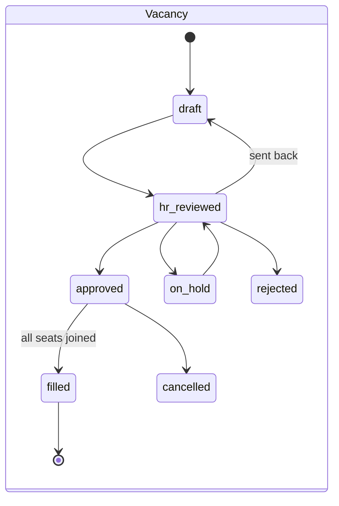
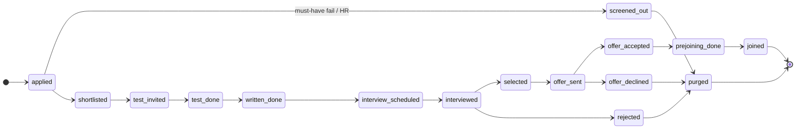

# Onboarding Process — Architecture (workforce planning → recruitment → joining)

> Module handbook. Read this before touching any file of the module, and update it after every build step
> (status table §1, file map §3, schema §5, RPCs §7). The project-wide handbook is `memory.md` (repo root);
> this file owns the details of this module and `memory.md` points here.

Status: **design agreed, no code yet** (2026-10-25). Final settlement is a **separate module, built later**.

---------------------------------------------------------------------------------------------------------------------
## 0. What the module does (one paragraph)

The system measures each department's workload against its capacity every month. When a department is overloaded,
or someone leaves a sanctioned position, a **vacancy is drafted automatically** and goes through approval. An approved
vacancy becomes a **job post auto-filled from the designation's job profile**, published on the company's own
careers page. Applications (own form, email, LinkedIn, Bdjobs) land in temporary CV storage, are parsed and
**ATS-scored**, and shortlisted applicants take the **online objective test on our own recruitment page**, so their
score reaches the admin dashboard at once. A written test on paper follows, then an interview is scheduled within
15 days. Applicants get an email (later SMS) with a pre-interview form, a panel of 1–4 interviewers scores online,
and a composite result is computed. The selected person gets an offer and a mandatory pre-joining form
(NID, photo, nominee, bank). On the joining day the person becomes an employee automatically, documents are
generated pre-filled for printing and signing, and a named joining-day feedback form is sent.

---------------------------------------------------------------------------------------------------------------------
## 1. Build steps and status

| Step | Content | Status |
|---|---|---|
| **R1** | Headcount plan, workload (4 methods, (?) tooltips), vacancy draft + approval, workforce dashboard, 10 demo cases | ⏳ not started |
| **R2** | Job profiles → job post (text + poster) → careers page + apply form + temporary CV storage | ⏳ |
| **R3** | CV parsing (AI), ATS gate + score, markdown profile, report table, profile modal | ⏳ |
| **R4** | Question generation + review, online objective test (own page), written-test marks entry, interview scheduling | ⏳ |
| **R5** | Email (now) / SMS (coded, off), pre-interview form, interviewer kit, panel scoring, composite result | ⏳ |
| **R6** | Offer (maker-checker) / reject email, pre-joining form (NID, photo, nominee, bank) | ⏳ |
| **R7** | Joining automation (pre-hire → employee), documents to print and sign, joining feedback, data purge | ⏳ |
| Later | Final settlement (separate module) | — |

Every step: migration + SQL golden test + pure-TS mirror with vitest + UI, then `npm run test:all`, typecheck,
build, commit, update this file and `memory.md` A9.

---------------------------------------------------------------------------------------------------------------------
## 2. Decisions (user answers 2026-10-25)

| # | Topic | Decision |
|---|---|---|
| 1 | Order | Onboarding/recruitment first; final settlement later as its own module. |
| 2 | Headcount | Companies set **sanctioned headcount** in the system (new headcount plan). |
| 3 | Vacancy | **Auto-drafted** (separation or overload); a person approves. |
| 4 | Workload | Linked to **output data**, not only attendance/OT. Method per department. Every formula and its source on a (?) hover. Sources verified, never typed from memory. |
| 5 | AI | Claude API now (platform key for testing). Each company can paste **its own API key** in Settings → Integrations (masked input, save, test, remove). Without any key the module runs in manual mode. |
| 6 | Messaging | **Email now** (testing phase). **SMS adapter coded but switched off** until a gateway account exists. |
| 7 | Tests | **Own recruitment page** for the objective test (no Google Form): submitting updates the score on the admin dashboard immediately. Written test stays on paper; HR enters marks. |
| 8 | Score | Default weights ATS 10 / Objective 25 / Written 20 / Interview 45 (editable per post, sum 100). Objective test has an **aptitude/reasoning section** instead of "IQ". "Confidence" = a category the **interviewer scores**. |
| 9 | Threshold | Overload = index ≥ 1.10 for 2 months in a row, or ≥ 1.25 in one month (explained in §6.4; company can change). |
| 10 | CV retention | **No retention after the process.** When the vacancy closes: rejected applicants are purged from the system; selected ones move into the employee record (photo/NID only; the CV is deleted too). |
| 11 | Applicant view | Clicking an applicant row opens the **full profile in a modal**. |
| 12 | Salary on post | **Toggle per post**: on → admin enters min/max; off → "Negotiable". |
| 13 | Joining feedback | **Named**, not anonymous. |
| 14 | Approval chain | *Default until the user says otherwise*: vacancy = drafted (system/Manager) → HR review → Admin approve (budget); offer = HR prepares → Admin approves (preparer ≠ approver). |
| 15 | Architecture | Recruitment needs outside calls (AI, email, SMS, captcha) → **Supabase Edge Functions** for those three jobs only (§9). Everything else stays in Postgres RPCs. |

---------------------------------------------------------------------------------------------------------------------
## 3. Where things live (file map)

Core logic lives in **`src/onboarding-process/`** (this folder). Two kinds of code must stay outside it because
the tooling expects them there:
- SQL migrations and tests → `supabase/migrations/`, `supabase/tests/` (the PGlite runner `scripts/db-test/run.mjs`
  and the manual SQL-Editor apply order read only those folders).
- Edge Functions → `supabase/functions/<name>/` (Supabase's required layout).

```
src/onboarding-process/                 ← core of the module (import as @/onboarding-process/...)
  architecture.md                       ← this file
  core/
    types.ts                            ← shared types (Vacancy, JobPost, Applicant, Scores …)
    workload.ts                         ← capacity, index, required FTE, gap, suggestion rules (mirror of SQL)
    attrition.ts                        ← attrition %, vacancy rate, time-to-fill
    jobPost.ts                          ← fill post from job profile, salary text ("Negotiable"), deadline
    ats.ts                              ← must-have gate + ATS score breakdown (mirror of SQL)
    assessment.ts                       ← objective scoring, written normalisation
    composite.ts                        ← composite score, weight renormalisation, interviewer spread flag
    schedule.ts                         ← 15-day window, slot proposal around leave/holiday/weekly off
    workflow.ts                         ← state machines + allowed transitions per status (§4.2)
    explain.ts                          ← text for every (?) tooltip: formula, numbers filled in, source key
  demo/
    workloadCases.ts                    ← the 10 demo cases + expected results (§6.6)
  integrations/
    providers.ts                        ← provider ids and config shapes (ai: claude; email: resend|smtp; sms: …)
  __tests__/                            ← vitest for every core file (golden numbers = SQL test numbers)

src/lib/onboarding.ts                   ← React Query hooks (calls RPCs; invalidate after mutations)
src/pages/onboarding/                   ← pages: Workforce, Vacancies, JobProfiles, JobPosts, Applicants,
                                          Assessments, Interviews, Offers, Onboarding cases
src/pages/onboarding/dialogs/           ← modals: ApplicantProfileModal, VacancyApproval, ScoreDialog …
src/pages/public/careers/               ← public pages: careers list, job detail + apply, test page,
                                          pre-interview form, pre-joining form, joining feedback
src/pages/settings/IntegrationsPage.tsx ← AI key / email / SMS settings (admin only)

supabase/migrations/2026102x…_recruit_r1_workforce.sql … _r7_joining.sql   ← one migration per step
supabase/tests/recruit_r1_workforce_test.sql …                              ← one golden test per step
supabase/functions/recruit-apply/       ← public apply: captcha, file checks, CV upload, insert
supabase/functions/recruit-ai/          ← AI job runner (CV parse, ATS relevance, question generation)
supabase/functions/recruit-notify/      ← sends queued email (and SMS when enabled)
```

---------------------------------------------------------------------------------------------------------------------
## 4. Process flow

### 4.1 End-to-end graph

```mermaid
flowchart TD
  subgraph R1["R1 · Workforce planning"]
    IN["Monthly inputs<br/>attendance + approved OT (Part 2)<br/>output × SMV · volumes × std time · staffing ratio"] --> SNAP["Workload snapshot per department<br/>index · required FTE · gap · vacancy · attrition"]
    SEP["Employee leaves<br/>(deactivate_employee)"] --> VD
    SNAP -->|"backfill rule or overload rule"| VD["Vacancy DRAFT (auto)"]
    VD --> HRR{"HR review"}
    HRR -->|"send back / hold"| VD
    HRR --> ADM{"Admin approve<br/>(budget check)"}
    ADM -->|"reject / hold"| HOLD["On hold / rejected"]
  end

  subgraph R2["R2 · Job post and applications"]
    ADM -->|"approved"| JP["Job post auto-filled<br/>from designation job profile"]
    JP --> PUB["Publish: careers page + link + poster (QR)"]
    PUB --> CH["Applications<br/>own form · email · LinkedIn · Bdjobs (HR upload)"]
    CH --> CV[("Temporary CV storage<br/>private bucket")]
  end

  subgraph R3["R3 · Screening"]
    CV --> PARSE["Parse CV → structured profile + markdown"]
    PARSE --> GATE{"Must-have gate<br/>experience · education"}
    GATE -->|"fail"| REJ
    GATE -->|"pass"| ATS["ATS score 0–100 with breakdown"]
    ATS --> TABLE["Report table · sort · filter · profile modal"]
    TABLE --> SL["Shortlist (HR)"]
  end

  subgraph R4["R4 · Tests and scheduling"]
    SL --> QG["AI drafts questions → HR reviews → bank"]
    QG --> OBJ["Online objective test (own page)<br/>auto-scored → dashboard"]
    OBJ --> WR["Written test on paper<br/>HR enters marks"]
    WR --> SCH["Interview proposed ≤ 15 days<br/>HR can edit / delete"]
  end

  subgraph R5["R5 · Interview"]
    SCH --> MSG["Email (SMS later) with pre-interview form link"]
    MSG --> KIT["Interviewer kit: profile, scores, AI questions, rubric"]
    KIT --> PANEL["1–4 interviewers score independently"]
    PANEL --> COMP["Composite result (+ PMS for internal candidates)"]
  end

  subgraph R6["R6 · Decision"]
    COMP --> OFF["Offer prepared (HR) → approved (Admin)"]
    COMP -->|"not selected"| REJ["Reject email"]
    OFF --> PJ["Offer email + mandatory pre-joining form<br/>NID · photo · nominee · bank"]
  end

  subgraph R7["R7 · Joining"]
    PJ --> CONV["Joining day: pre-hire → employee (auto)<br/>card ID · pay · shift · leave · reporting · portal"]
    CONV --> DOCS["Documents pre-filled → HR prints → joiner signs → scan uploaded"]
    CONV --> FB["Named joining-day feedback form"]
  end

  REJ --> CLOSE["Vacancy closed → purge rejected applicants' data"]
  DOCS --> CLOSE
```



### 4.2 Status machines





Other statuses: job post `draft → published → closed | cancelled`; offer `draft → approved → sent → accepted |
declined | expired`; interview `proposed → confirmed → done | rescheduled | cancelled`; notification
`queued → sent | failed`; AI job `queued → running → done | failed`. Allowed transitions are enforced in SQL; the
same table lives in `core/workflow.ts` only to show/hide buttons.

---------------------------------------------------------------------------------------------------------------------
## 5. Data schema (planned) — `public` unless noted

Conventions as in the rest of the project: `id uuid`, `org_id` + composite FKs `(org_id, id)`, standard triggers
(`attach_standard_triggers`: updated_at/by, audit, soft delete), closed tables (API roles read through views/RPCs),
money `numeric(12,2)`, dates in org timezone.

**R1 — workforce**
- `workforce_settings` (one per org): `capacity_mode` roster|fixed, `fixed_capacity_hours` (default 208),
  `availability_lookback_months` 3, `band_watch` 1.00, `band_overload` 1.10, `sustain_months` 2, `band_critical` 1.25,
  `band_underload` 0.85, `confirmed_at/by`.
- `headcount_plans`: department_id, designation_id, office_id (nullable = any office), `sanctioned` int,
  `monthly_budget` (department salary budget), `effective_from/to` (versioned, never edited).
- `workload_methods`: department_id, `method` hours|output_smv|volume_std|ratio, `params` jsonb
  (ratio: `{per_employees: 100}`), effective_from/to.
- `workload_inputs`: department_id, `period_month`, `metric_key` (style code / "voucher" / "call"), `quantity`,
  `std_minutes`, `source` manual|csv, entered_by. Unique (department, month, metric_key).
- `workload_snapshots`: department_id, period_month, `method`, `demand_hours`, `capacity_per_fte`, `active`,
  `sanctioned`, `vacancy`, `required_fte`, `gap`, `index`, `band`, `separations_3m`, `avg_headcount_3m`,
  `attrition_pct`, `explain` jsonb (every number + formula + reference keys). Rebuilt idempotently.
- `vacancies`: department_id, designation_id, office_id, `seats`, `reason` replacement|overload|new_position,
  `separated_employee_id` (nullable), `snapshot_id`, `estimated_monthly_cost`, `budget_status` ok|blocked,
  `status` (§4.2), `drafted_by` (null = system), `hr_reviewed_by/at`, `approved_by/at`, `decision_note`.
- `vacancy_events` (append-only history).

**R2 — job profiles, posts, applicants**
- `job_profiles` (one current version per designation): `experience_min/max_years`, `education` jsonb
  (`[{level: "honours", subjects: ["Accounting","Finance"]}]`), `required_skills` text[], `nice_skills` text[],
  `duties` text, `employment_type`, `version`, effective_from.
- `job_posts`: vacancy_id, profile snapshot jsonb (post never changes when the profile changes later), `title`,
  `description_md`, `show_salary` bool, `salary_min/max` (required when show_salary), `deadline` (default +14 days),
  `public_slug`, `poster` jsonb (template id, colours), `weights` jsonb (default 10/25/20/45),
  `has_written_test` bool, `status`.
- `applicants`: job_post_id, `full_name`, `email`, `phone` (+880…), `source` form|email|linkedin|bdjobs|other,
  `consent_at`, `cv_path` (storage), `is_internal` + `employee_id` (internal candidates), `status` (§4.2),
  `purged_at`. Unique (job_post_id, lower(email)).
- `applicant_events` (append-only; ids and status only, no personal data).
- Storage bucket `recruit-cvs/{org}/{job_post}/{applicant}.pdf|docx` (private, ≤ 5 MB, PDF/DOCX only).

**R3 — screening**
- `applicant_profiles`: applicant_id, `parsed` jsonb (years, education, skills, roles), `markdown`,
  `must_have_pass`, `must_have_reasons` jsonb, `ats_score`, `ats_breakdown` jsonb, `parsed_by` ai|manual, `ai_job_id`.
- `ai_jobs`: `kind` parse_cv|relevance|gen_questions|interview_questions, `status`, `input_ref` jsonb,
  `output` jsonb (validated against a schema), `model`, `input_tokens`, `output_tokens`, `error`, `key_source` org|platform.

**R4 — assessments and scheduling**
- `question_bank`: designation_id (nullable = general), `kind` objective|written, `section`
  aptitude|job_knowledge|language|situational, `stem`, `options` jsonb, `answer_key` (closed column, never in views
  for applicants), `marks`, `difficulty`, `status` draft|approved, `reviewed_by` (AI drafts are unusable until approved).
- `assessments`: job_post_id, `kind`, `question_ids` uuid[], `duration_minutes`, `total_marks`, `pass_percent`,
  `negative_marking` bool (default false).
- `assessment_invites`: applicant_id, assessment_id, `token_hash` (sha-256; raw token only in the link),
  `expires_at`, `started_at`, `submitted_at` (one attempt; server-side timer = started_at + duration + 60 s grace).
- `assessment_answers` (append-only), `assessment_results` (score, percent, `section_scores` jsonb).
- `written_marks`: applicant_id, per-question marks, `entered_by` (audited).
- `interview_schedules`: applicant_id, `starts_at`, `location` / `online_link`, `panel` uuid[] (employee ids),
  `due_by` (= result date + 15 days), `status`, `proposed_by` system|user.

**R5 — messaging and interview**
- `message_templates` (key, channel, language en|bn, subject, body with `{placeholders}`).
- `notifications` (queue): channel email|sms, template_key, `to`, payload jsonb, `status`, `provider_ref`, `error`,
  `attempts`. Never stores secrets.
- `preinterview_forms`: applicant_id, token_hash, answers jsonb, submitted_at.
- `interview_scores`: schedule_id, interviewer (employee), category scores 1–5 (`job_knowledge`, `communication`,
  `problem_solving`, `confidence`, `culture_fit`), `comment`, `submitted_at`. Unique (schedule, interviewer).
- `candidate_results`: applicant_id, `components` jsonb (each % and weight), `composite`, `spread`, `spread_flag`,
  `decision` selected|rejected|waitlist, decided_by.

**R6 — offer and pre-joining**
- `offers`: applicant_id, designation/grade/office, `salary_template_id`, `gross`, `joining_date`, `expires_at`,
  `status`, `prepared_by`, `approved_by` (≠ prepared_by).
- `prehire_records`: applicant_id, token_hash, personal fields (as `employees`), `nid_number` (encrypted,
  last4 clear), `nominees` jsonb, payment account (encrypted, last4), `photo_path`, `signature_path`,
  `submitted_at`, `verified_by/at`.

**R7 — joining**
- `onboarding_cases`: offer_id, `employee_id` (after conversion), joining_date, `status` pending|converted|completed.
- `onboarding_tasks`: case_id, `kind`, `status` todo|done, done_by/at (checklist).
- `onboarding_documents`: case_id, `kind` appointment_letter|joining_report|nominee_form|pf_nomination|
  code_of_conduct|id_card, `generated_at`, `signed_scan_path`, `signed_at`, `uploaded_by`.
- `joining_feedback`: case_id, employee_id (**named**), ratings jsonb (`overall`, `recruiter_behaviour`,
  `clarity`, `first_day`), comment.

**Integrations (shared)**
- `org_integrations`: `kind` ai|email|sms, `provider`, `enabled`, `config` jsonb (model, sender, from address),
  `secret_enc` (pgp_sym_encrypt), `secret_last4`, `tested_at`, `test_status`.
- `private.platform_integrations`: super-admin fallback keys (testing). Not readable by any API role.

---------------------------------------------------------------------------------------------------------------------
## 6. Calculations

Every number below is stored with an `explain` entry (formula, the numbers filled in, reference keys) and shown by
the (?) tooltip. Reference keys live in `statutory_references` with a new category **`industry_practice`**
(e.g. `workload.smv`, `hr.attrition_rate`) next to `law` items (`bd.working_hours`). All sources are verified
during the build and marked `needs_confirmation` until then — never typed from memory.

### 6.1 Capacity per FTE (hours a month one person can really work)
- `roster` mode: `scheduled_hours` = Σ over the month's working days (roster/default shift, minus weekly offs and
  holidays) of (shift length − break).
- `fixed` mode: `fixed_capacity_hours` (default 208 = 26 days × 8 h; company confirms).
- `availability` = 1 − (leave hours + absent hours) ÷ scheduled hours, averaged over the last 3 months (Part 2 data).
- **capacity_per_fte = scheduled_hours × availability**. The demo uses 200 h.

### 6.2 Demand hours per method
| Method | Demand hours | Typical department |
|---|---|---|
| `output_smv` | Σ (pieces × SMV minutes) ÷ 60 | RMG sewing, cutting, finishing |
| `volume_std` | Σ (count × standard minutes) ÷ 60 (+ fixed hours, e.g. month-close) | Accounts, customer service, store |
| `ratio` | (org active employees ÷ per_employees) × capacity_per_fte | HR, admin, security |
| `hours` | worked hours + approved OT hours (Part 2 records) | anything without output data |

### 6.3 Department figures
- **index** = demand_hours ÷ (active × capacity_per_fte)
- **required_fte** = demand_hours ÷ capacity_per_fte
- **gap** = required_fte − active
- **vacancy** = sanctioned − active (never below 0)
- **attrition %** = separations in the period ÷ average headcount in the period × 100
- **vacancy rate %** = vacancy ÷ sanctioned × 100
- **band**: ≥ 1.10 overload · 1.00–1.10 watch · 0.85–1.00 balanced · < 0.85 underloaded

### 6.4 Suggestion rules (the threshold, explained)
- Index **1.10** means the team does 10 % more work than its capacity. One heavy month (for example, orders before
  Eid) is not a reason to hire, so the system needs **2 months in a row** at ≥ 1.10.
- Index **1.25** means 25 % more work than capacity. That is serious enough to act on after **one month**.
- **Backfill (inside sanction)**: `seats = min(vacancy, ceil(gap))` when vacancy > 0 and gap > 0.
- **New position (raises sanction)**: when the overload rule fires, `extra = ceil(required_fte) − sanctioned`
  (if > 0), drafted as `reason = new_position`; only an Admin can approve because it changes the headcount plan.
- **Vacancies kept on hold**: `vacancy − backfill seats` (shown as a saving).
- **Budget check**: `estimated_monthly_cost` = gross from the designation's salary template (or the leaver's gross
  for a replacement) × seats; if current department payroll + cost > `monthly_budget` → `budget_status = blocked`
  for the seats that do not fit, shown next to "OT cost last month" for comparison.
- **Attrition flag**: attrition % over 3 months above 20 % → "check exit reasons" (company can change the limit).
- **Separation trigger**: `deactivate_employee` on a person in a sanctioned position drafts a replacement vacancy at
  once; the next monthly snapshot then decides the suggested seats.

### 6.5 Screening and selection scores
- **Must-have gate**: experience ≥ `experience_min_years` and education level ≥ required. Fail → `screened_out`
  (HR can override with a reason, audited).
- **ATS score (0–100)** = skills 40 + experience 25 + education 20 + relevance 15
  - skills = 40 × matched required ÷ total required (+ up to 5 bonus for nice-to-have, capped at 40)
  - experience = 25 inside the range or above it (no over-qualification penalty — it can act as an age proxy);
    below the minimum is already a gate fail
  - education = 15 for the required level + 5 for a listed subject
  - relevance = 0–15 from the AI judgement of past roles vs duties, with a one-line reason; manual mode = HR enters it
  - Never scored: gender, age, religion, marital status, photo, address.
- **Objective %** = Σ correct marks (− wrong × penalty if negative marking) ÷ total × 100; plus per-section %.
- **Written %** = Σ entered marks ÷ total × 100.
- **Interview %**: each interviewer's mean of the 5 categories → panel mean m (1–5) → `(m − 1) ÷ 4 × 100`.
  `spread` = max − min of interviewer means; **spread_flag** when > 1.5.
- **Composite** = Σ weight_i × component_i ÷ Σ weights of the components present (a post without a written test
  renormalises). Internal candidates add **PMS** (latest acknowledged review, `(score − 1) ÷ 4 × 100`) with weight 15,
  the other weights scaled by 0.85.
- Worked example (external): ATS 72, Objective 80, Written 65, Interview mean 4.2 → 80 →
  0.10×72 + 0.25×80 + 0.20×65 + 0.45×80 = 7.2 + 20 + 13 + 36 = **76.2**.
- Worked example (internal, PMS 4.0 → 75): 0.085×72 + 0.2125×80 + 0.17×65 + 0.3825×80 + 0.15×75
  = 6.12 + 17 + 11.05 + 30.6 + 11.25 = **76.02**.

### 6.6 Scheduling
- `due_by` = date the written result is published + 15 days.
- Proposal = earliest day ≥ result + 2 days (notice for the applicant) that is a working day for **every** panel
  member (not on approved leave, not a holiday, not their weekly off) and inside their shift; slot length 45 min.
  If none fits before `due_by`, the system says so and HR picks a date. HR can always edit, reschedule or delete.

### 6.7 The 10 demo cases (golden test for R1; capacity_per_fte = 200 h, sustain = 2 months)

| # | Department | Method | Demand h | Active | Sanct. | Left 3m | Index | Req. FTE | Gap | Expected suggestion |
|---|---|---|---|---|---|---|---|---|---|---|
| 1 | Sewing Line 1 | 54,000 pcs × 12 min | 10,800 | 50 | 55 | 3 | 1.08 watch | 54 | 4 | backfill **4**, 1 on hold |
| 2 | Cutting | 120,000 pcs × 1.2 min | 2,400 | 10 | 10 | 0 | 1.20 (2nd month) | 12 | 2 | **new position +2** (Admin) |
| 3 | Quality | hours | 3,150 | 15 | 16 | 1 | 1.05 watch | 15.75 | 0.75 | backfill **1** |
| 4 | Finishing | hours | 4,200 | 25 | 27 | 2 | 0.84 underloaded | 21 | −4 | backfill 0, **2 on hold** |
| 5 | Accounts | 6,000 vouchers × 15 min + 300 h | 1,800 | 8 | 9 | 1 | 1.125 (2nd month) | 9 | 1 | backfill **1** Senior Executive (post auto-filled); new position 0 |
| 6 | HR & Admin | ratio 1 : 100, 850 employees | 1,700 | 6 | 8 | 1 | 1.42 critical | 8.5 | 2.5 | backfill **2** + **new position +1** |
| 7 | Sales | hours | 2,640 | 12 | 12 | 0 | 1.10 (1st month) | 13.2 | 1.2 | **watch only** (not sustained) |
| 8 | Customer Service | 9,000 calls × 6 + 3,000 tickets × 12 | 1,500 | 6 | 8 | 2 | 1.25 critical | 7.5 | 1.5 | backfill **2**; new position 0; **attrition flag 28.6 %** (avg headcount 7) |
| 9 | IT | hours | 1,000 | 5 | 5 | 0 | 1.00 balanced | 5 | 0 | nothing |
| 10 | Store / Warehouse | volume | 2,400 | 10 | 12 | 2 | 1.20 (2nd month) | 12 | 2 | backfill 2 → **1 approved, 1 budget blocked** |

---------------------------------------------------------------------------------------------------------------------
## 7. RPC catalog (planned)

- **R1**: `save_workforce_settings`, `save_headcount_plan`, `save_workload_method`, `save_workload_inputs`
  (manual + CSV rows), `build_workload_snapshots(month)`, `get_workforce_dashboard(month)`, `list_vacancies`,
  `draft_vacancy`, `review_vacancy`, `decide_vacancy`, `seed_workforce_demo` (demo org only).
  Hook: `deactivate_employee` → `private.draft_replacement_vacancy`.
- **R2**: `save_job_profile`, `create_job_post_from_vacancy`, `update_job_post`, `publish_job_post`, `close_job_post`,
  anon view `public_job_posts_v` (published only, safe columns), `upload_applicants` (HR bulk, with source),
  `list_applicants`, `get_applicant`.
- **R3**: `queue_cv_parse`, `save_manual_profile`, `override_must_have`, `shortlist_applicants`, `get_ats_report`.
- **R4**: `queue_question_generation`, `review_question`, `save_assessment`, `invite_to_assessment`,
  anon-by-token `start_assessment(token)`, `submit_assessment(token, answers)`, `enter_written_marks`,
  `propose_interview`, `save_interview_schedule`, `cancel_interview`.
- **R5**: `send_message(template, applicants)`, anon-by-token `submit_preinterview_form`, `get_interviewer_kit`,
  `submit_interview_score`, `get_candidate_results`, `decide_candidate`.
- **R6**: `prepare_offer`, `approve_offer`, `send_offer`, anon-by-token `respond_offer`, `submit_prejoining_form`,
  `verify_prejoining`.
- **R7**: `convert_prehire_to_employee` (reuses `create_employee`, `set_initial_compensation`, roster/leave defaults,
  `set_reporting_line`, `grant_portal_access`, `save_payment_account`), `generate_onboarding_documents`,
  `upload_signed_document`, `complete_onboarding_task`, anon-by-token `submit_joining_feedback`,
  `close_vacancy` (runs the purge, §8.5).
- **Integrations**: `save_integration` (secret write-only), `remove_integration`, `test_integration`
  (via Edge Function), `get_integrations` (no secrets, last4 only).

---------------------------------------------------------------------------------------------------------------------
## 8. Security

### 8.1 Permissions (new)
| Permission | Default role |
|---|---|
| `workforce.view` | HR, Admin; Manager for own departments (read only) |
| `headcount.manage` | Admin only (budget) |
| `vacancy.request` | Manager, HR |
| `vacancy.review` | HR |
| `vacancy.approve` | Admin (never the person who reviewed) |
| `recruit.manage` (profiles, posts, applicants, shortlist) | HR |
| `assessment.manage` (questions, tests, written marks) | HR |
| `interview.schedule` | HR |
| `interview.score` | only interviewers on that panel (row check, not a role grant) |
| `offer.prepare` / `offer.approve` | HR / Admin (preparer ≠ approver) |
| `onboarding.manage` | HR |
| `integrations.manage` | Admin only, never grantable |

### 8.2 Public surfaces (no login)
- Careers list and job detail: anon `select` on `public_job_posts_v` only (published, safe columns; salary only
  when `show_salary`).
- Apply: **Edge Function `recruit-apply`** — captcha verified server-side, rate limit per IP and per email,
  PDF/DOCX ≤ 5 MB checked by content type and magic bytes, consent required, duplicate email per post refused.
- Test page, pre-interview form, offer response, pre-joining form, joining feedback: **single-purpose token links**
  (32 random bytes, only the sha-256 stored, expiry, one use where it matters). The pre-joining form also needs an
  email OTP because it collects NID and bank data.
- Objective test: answer key never leaves the database; timer and single attempt enforced on the server.

### 8.3 Personal data
- NID and account numbers: encrypted with the existing `private.app_secrets` key (pgp_sym_encrypt), last 4 kept
  clear for masking, never returned to forms, reveals audited — the same rules as Part 1 / Part 3A.
- **Audit log**: recruitment tables log ids, status and changed field names only — no names, emails, phones,
  CV text or answers (the audit log is append-only and would otherwise keep data we promised to purge).
- Interviewers see only their own panel's applicants; scores of other interviewers stay hidden until they submit.

### 8.4 AI and integration secrets
- Keys are **write-only** from the UI: saved encrypted in `org_integrations.secret_enc`, shown as `••••last4`,
  removable. Only Edge Functions can decrypt, through a `private` function granted to `service_role` only.
  The service-role key exists **only inside Edge Functions** (injected by Supabase); never in the repo, `.env`
  or the browser.
- Key choice per job: org key → platform key (only if a super admin enabled it for that org, testing) → manual mode.
- **CV text is untrusted data.** It is sent to the model as a document with instructions to return JSON only; the
  output is validated against a schema; the model can never change a status, send a message or decide — it only
  fills fields that HR reviews. Usage (tokens, model) is logged per job.

### 8.5 Retention and purge (decision 10)
- `close_vacancy` (HR, confirm dialog with counts): for every applicant not converted to an employee → delete CV
  file, parsed profile, answers, written marks, interview notes, pre-interview and pre-joining data; clear name,
  email, phone; set `purged_at`. Kept: anonymous counts for the funnel and time-to-fill.
- Selected applicants: photo, signature and NID scan move into `employee-files/{org}/{employee}/`; the CV is deleted.
- A nightly job (pg_cron) also purges posts closed for more than 30 days that HR forgot to close out.

---------------------------------------------------------------------------------------------------------------------
## 9. Integrations

| Channel | Now | Design |
|---|---|---|
| AI | **On** (Claude; platform key for testing, org key from Settings → Integrations) | `recruit-ai` Edge Function reads `ai_jobs` (queued by RPCs), calls the Messages API, validates JSON, writes back. Model configurable per org (default `claude-sonnet-5-5`; CV parsing can use `claude-haiku-5-5` to save cost). |
| Email | **On** (testing) | `recruit-notify` sends `notifications` rows through the chosen provider (Resend API or SMTP). A verified sender domain is needed before real applicants get mail. |
| SMS | **Coded, off** | Same queue; provider adapter interface (`send(to, text) → provider_ref`) with a generic HTTP adapter for BD gateways; needs a gateway account and a registered sender ID before switching on. |
| Captcha | On with apply | Verified inside `recruit-apply`. |
| Scheduled jobs | pg_cron | monthly snapshot (1st of month), 15-day interview reminder, token expiry, purge. Until pg_cron is set, HR has "Run now" buttons. |

Deploying Edge Functions: the terminal blocks database ports, but HTTPS works — try `supabase functions deploy`
first; otherwise paste each function in the Supabase Dashboard editor. Secrets are set in the Dashboard.

---------------------------------------------------------------------------------------------------------------------
## 10. UI map (planned)

- **Workforce** `/workforce`: month picker, department cards (index gauge coloured by band, (?) on every number),
  vacancy / attrition KPIs, suggestions list with "Draft vacancy" actions, input screen (manual + CSV), headcount
  plan, settings (bands, capacity mode).
- **Vacancies** `/vacancies`: list by status, approval dialog showing the snapshot explanation and budget check.
- **Job profiles** `/job-profiles`; **Job posts** `/job-posts/:id`: text editor, poster preview (PNG download, QR),
  salary toggle → "Negotiable", publish/close, share link.
- **Applicants** `/job-posts/:id/applicants`: report table (sort, filter, shortlist); **row click → profile modal**
  (markdown profile, ATS breakdown, test scores, interview scores, timeline, CV preview while it exists).
- **Assessments**, **Interviews** (calendar + list, edit/delete), **Interviewer kit** (panel members only),
  **Offers**, **Onboarding cases** (checklist, documents, signed uploads).
- **Dashboard (Admin)**: funnel per vacancy (applied → screened → shortlisted → test → interview → offer → joined),
  time-to-fill, open vacancies, top candidates.
- **Public** `/careers/:orgCode`, `/careers/:orgCode/:slug` (apply), `/t/:token` (test), `/f/:token` (forms).
- **Settings → Integrations** `/settings/integrations` (Admin).

---------------------------------------------------------------------------------------------------------------------
## 11. Memory and documentation rules for this module

- This file is the module's memory: after each R-step update §1 status, §3 file map (real paths), §5/§7 with what
  was actually built, and add any changed decision to §2 with the date.
- `memory.md` (root) keeps only the summary: A9 status rows for the recruit migrations, Part B decisions, and a
  pointer to this file. Supabase apply status is confirmed by probing with the anon key, never assumed.
- Golden numbers in §6.5–§6.7 are written before the code and must match both the SQL test and the vitest mirror.

## 12. Open questions
- Approval chain (§2 #14) is a default — confirm or change.
- Email provider (Resend vs SMTP) and sender domain.
- Default category weights inside the interview score (equal for now).
- Which BD SMS gateway, when the account exists.
